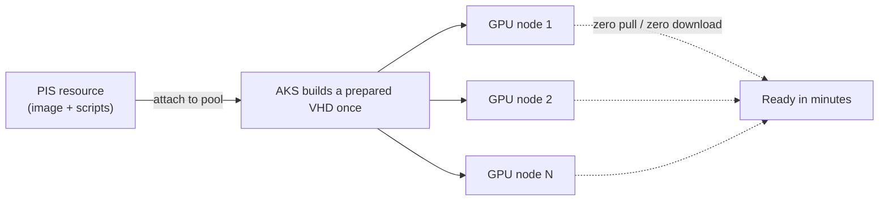

# Faster GPU scale-out with Prepared Image Specification (PIS)

Bake the slow parts of a GPU node — the container image, the model weights, and
even a pinned GPU driver — into the node image **once** with Prepared Image
Specification (PIS), so every subsequent GPU node boots ready instead of
downloading gigabytes at scale-out.

Where the other GPU codelabs in this folder provision nodes and install drivers
at runtime, this one moves that work to **image-build time**. Each example is
self-contained and demonstrates one PIS capability on an NVIDIA H100 node pool.

For the official reference, see the AKS docs:
[Prepared Image Specification overview](https://learn.microsoft.com/azure/aks/prepared-image-specification-overview)
and [Create and manage a Prepared Image Specification](https://learn.microsoft.com/azure/aks/prepared-image-specification).

## What you'll build



## The three examples

| # | Example | What you bake | Why it matters |
|---|---|---|---|
| 1 | [Bake model weights](1-bake-model-weights.md) | A 15 GB Qwen2.5-7B checkpoint onto the node's local **NVMe** | The model is on local disk at boot — no model download at scale-out |
| 2 | [Pre-cache a container image](2-precache-container-image.md) | The `vllm/vllm-openai` inference image | No image pull at scale-out — the slowest part of GPU pod startup |
| 3 | [Bake a custom GPU driver](3-custom-gpu-driver.md) | A pinned NVIDIA `595.91.07` driver | Pin an exact driver version that survives the AKS node bootstrap |

Each example is **independent once you've done the shared
[one-time setup](#one-time-setup)** below — run them in any order. If you're new
to PIS, start with Example 2: it's the simplest and has no customization script.

## Learning objectives

After these examples you'll be able to:

- Create a PIS resource and attach a version to a GPU node pool to trigger a bake.
- Bake large model weights onto fast local NVMe storage and serve them with zero
  network at scale-out.
- Pre-cache a large container image so GPU pods start without an image pull.
- Bake a pinned custom GPU driver that survives the AKS node bootstrap, and make
  the node schedulable with the NVIDIA GPU Operator.
- Recognize the PIS trade-off (one-time bake cost vs. repeated fast scale-out)
  and the H100 capacity/cost caveats.

## Time and cost

- **Time:** 45–60 minutes per example, most of it the one-time image bake
  (~25–40 minutes) plus GPU node boot.
- **Cost:** An H100 node pool is billed while it exists — `Standard_NC40ads_H100_v5`
  is an expensive SKU. **Delete the GPU pool the moment you finish validating an
  example.** The prepared image is built **per node pool**.
- **Cleanup:** Run the cleanup section of each example (it waits so you can
  confirm the node is gone), or delete the whole resource group at the end (see
  [below](#clean-up)).

## Prerequisites

- An Azure subscription with `az login` completed and permission to create AKS
  clusters, node pools, and resource groups.
- An AKS cluster on a supported Kubernetes version (validated on **1.35.6**).
- Azure CLI **≥ 2.85.0** and the **`aks-preview`** extension **≥ 21.0.0b5**.
- The **`AKSPreparedImageSpecificationPreview`** and (for the managed GPU stack in
  Examples 1–2) **`ManagedGPUExperiencePreview`** feature flags registered in your
  subscription (see [the shared setup](#one-time-setup)).
- **H100 quota *and* capacity** in your target region.
- `kubectl` and, for Example 3, Helm 3.

## One-time setup

These steps are shared by all three examples. Run them once. **Run every command
in these examples from this codelab's directory** — the examples reference the
customization scripts with relative paths (`scripts/…`).

```bash
# 0. Get the codelab files and work from this directory (clone, or if you already
#    have the repo, just cd into it). The relative paths below depend on this.
git clone --depth 1 https://github.com/Azure/AKS.git
cd AKS/examples/end-to-end-AI-codelabs/prepared-image-specification-gpu-scaleout

# 1. Environment used throughout. Set SUB FIRST so the preview is registered in
#    the SAME subscription the cluster and PIS resources are created in.
export SUB=<your-subscription-id>
export RG=pis-gpu-codelab
export LOC=westeurope            # a region with H100 quota AND capacity
export ZONE=3
export CLUSTER=pis-gpu-codelab
export GPU_SKU=Standard_NC40ads_H100_v5

# 2. CLI + preview extension
az extension add --name aks-preview        # or: az extension update --name aks-preview
az --version                               # confirm az >= 2.85.0

# 3. Register the preview features in $SUB, then refresh the resource provider.
#    PIS for all examples; ManagedGPUExperiencePreview for the managed GPU stack
#    used in Examples 1-2.
for F in AKSPreparedImageSpecificationPreview ManagedGPUExperiencePreview; do
  az feature register --subscription $SUB --namespace Microsoft.ContainerService --name $F
done
# wait until both read "Registered":
for F in AKSPreparedImageSpecificationPreview ManagedGPUExperiencePreview; do
  az feature show --subscription $SUB --namespace Microsoft.ContainerService --name $F --query properties.state -o tsv
done
az provider register --subscription $SUB --namespace Microsoft.ContainerService

# 4. Resource group (tag it so a shared-sub janitor doesn't reap it mid-bake)
az group create -n $RG -l $LOC --subscription $SUB \
  --tags doNotDelete=true skipAutoDelete=true

# 5. Cluster with a CPU system pool (AKS picks a default Kubernetes version and
#    VM size for you; pass --kubernetes-version / --node-vm-size to pin them)
az aks create -g $RG -n $CLUSTER --subscription $SUB --location $LOC \
  --node-count 3 --nodepool-name system --network-plugin azure --generate-ssh-keys

az aks get-credentials -g $RG -n $CLUSTER --subscription $SUB --overwrite-existing
```

> **Registration can lag.** `az feature register` + `az provider register` can
> take **10+ minutes** to propagate. Until they do, PIS creates/attaches fail
> (e.g. `MissingSubscriptionRegistration` or `InvalidResourceType`). Wait until
> the feature state reads `Registered` **and** the provider re-registration has
> finished before creating a PIS; retry for a few minutes if an early call fails.

> **Preview on preview.** Examples 1–2 combine two preview features (PIS +
> managed GPU). Previews are not covered by production SLAs/support, and the
> combined behavior can change. Don't use this configuration for production
> workloads.

### The PIS read-permission grant

Attaching a PIS to a node pool fails with `ResourceMissingPermissionError` unless
the **cluster identity** has **Reader** on the PIS resource. This is separate from
any bake identity. After you create a PIS (in each example), grant it:

```bash
CP_PRINCIPAL=$(az aks show -g $RG -n $CLUSTER --subscription $SUB \
  --query identity.principalId -o tsv)
PIS_ID=$(az aks prepared-image-specification show -g $RG --name <pis-name> \
  --subscription $SUB --query id -o tsv)
az role assignment create --assignee-object-id "$CP_PRINCIPAL" \
  --assignee-principal-type ServicePrincipal --role Reader --scope "$PIS_ID"
```

## How PIS works (30-second version)

1. You create a **PIS resource** that lists container images to cache and/or
   customization scripts to run.
2. You attach a **PIS version** to a node pool. AKS spins up a temporary **build
   VM**, runs your scripts, caches your images, and snapshots a **prepared VHD**.
3. Every node in that pool — now and on every scale-out — boots from the prepared
   VHD, skipping the pull/download/install work.

PIS versions are **immutable**. To change an image or script, create a new
version and point the pool at it. Updating tags on the PIS resource does **not**
change a version's contents.

> **When is PIS worth it?** When a pool scales out **repeatedly**. The bake is a
> one-time front-loaded cost (~25–40 min); the payoff is every node that boots
> from the result. For a pool that never scales, the bake can cost more than it
> saves.

For the full feature reference — all supported customizations, limitations, and
the complete CLI surface — see
[Prepared Image Specification in AKS](https://learn.microsoft.com/azure/aks/prepared-image-specification-overview)
and [Create and manage a PIS](https://learn.microsoft.com/azure/aks/prepared-image-specification).

## Clean up

```bash
# Removes the cluster, all GPU pools, PIS resources, and prepared images.
# Target $SUB explicitly so you don't rely on (or accidentally hit) a different
# CLI default subscription.
az group delete -n $RG --subscription $SUB --yes --no-wait
```

## Validation status

Every command and number in these examples was executed end-to-end on
`Standard_NC40ads_H100_v5` (1× H100 NVL 94 GB) in `westeurope` zone 3, AKS
Kubernetes 1.35.6, node image `AKSUbuntu-2404gen2containerd` /
kernel `6.8.0-1073-azure` / containerd 2.3.7, `aks-preview` with the PIS command
group. See each example's own **Validation status** section for its measured
timings.
