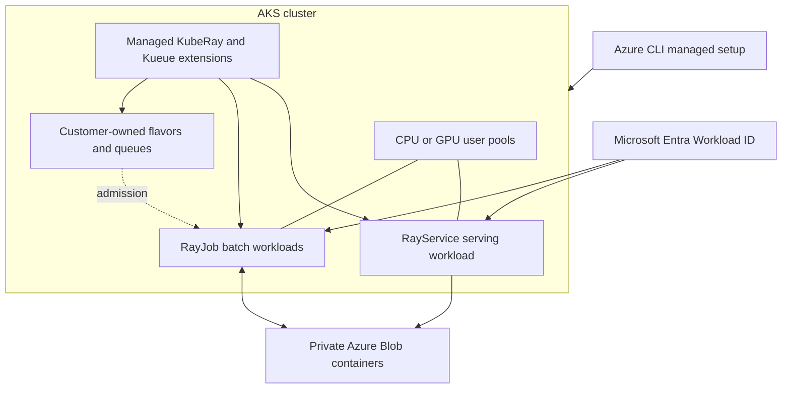

# Managed KubeRay and Kueue examples on AKS

Run Ray training, inference, and serving on Azure Kubernetes Service with the
**managed KubeRay and Kueue extensions**. This is the recommended path. You own
the Ray runtime images, application code, queue policies, storage, and workload
identity; the extensions manage their supported operators and APIs.

## Start here

1. [Module 1 — Managed setup](1-infrastructure/managed/): select an AKS cluster,
   prepare capacity, run the executable managed-operator installer, and prepare
   private storage, workload identity, and datasets.
2. [Module 2 — Queues](2-kueue-queues/): create your customer-owned namespace,
   ServiceAccount, placement flavors, and one queue configuration.
3. [Module 3 — Workloads](3-workloads/): submit a workload and observe admission,
   pod readiness, application output, and stored results.

The CPU autoscaler example is independent of the Ray workloads. Start at
[Module 2's CPU queue](2-kueue-queues/#cpu-autoscale-queue) and follow the
[CPU Job guide](3-workloads/cas-batch-job/). It needs no Ray runtime, GPU, storage,
or workload identity. Its pool starts at one four-vCPU user node so the Job's
three 1,800m-CPU pods can't all fit without scaling.

## Architecture

Kueue controls **when batch workloads are admitted**. KubeRay manages the Ray
cluster lifecycle after admission. Kubernetes schedules pods on the capacity
provided by AKS. These stages aren't interchangeable: queue quota isn't a
physical-capacity guarantee, and operator readiness isn't a completed workload.



The serving example uses a long-lived RayService without a queue-name label,
separately from the batch admission sequence. Plan capacity for it explicitly.

## Example selection

| Example | Resource | Capacity and dependencies |
| --- | --- | --- |
| [Aurora fine-tuning](3-workloads/aurora-finetune/) | RayJob | One A100, WeatherBench2 inputs, private storage, and workload identity. |
| [LLM training](3-workloads/llm-training/) | RayJob | Four A100 workers, ViGGO data, private storage, and workload identity. |
| [Batch inference](3-workloads/batch-inference/) | RayJob | One A100 and the completed LLM training adapter. |
| [Online serving](3-workloads/online-serving/) | RayService | One GPU and the completed Aurora checkpoint. |
| [CPU autoscaling](3-workloads/cas-batch-job/) | Job | Managed Kueue, its provisioning defaults, and an autoscaling CPU user pool. |

The Ray examples retain their customer-owned `default` and `gpu` placement
flavors. The CPU autoscaler example instead references existing managed
`aks-cpu`, `aks-provisioning-check`, and `aks-provisioning-config`. Never recreate
or delete the managed defaults to make a sample fit.

## Managed quick start

Use an explicitly selected, clean AKS 1.34 or later target. See Module 1 for
capacity, tool, provider, identity, and dataset prerequisites. The installer uses
a private kubeconfig and doesn't switch global contexts or subscriptions:

```bash
export SUBSCRIPTION_ID="<subscription-id>"
export RESOURCE_GROUP="<resource-group>"
export CLUSTER_NAME="<existing-aks-cluster>"

cd 1-infrastructure/managed
./install-extensions.sh
source .managed/managed.env
```

Complete the [storage/identity setup](1-infrastructure/managed/#prepare-storage-and-workload-identity)
and [dataset preparation](1-infrastructure/managed/data.md) before GPU examples.
Then, from the example root, configure one Ray queue and submit a workload:

```bash
cd 2-kueue-queues
# Follow this module's namespace and identity steps using your prepared IDs.
kubectl apply -f manifests/10-resource-flavors.yaml
kubectl apply -f manifests/20-single-queue.yaml

cd ../3-workloads/aurora-finetune
export AZURE_STORAGE_ACCOUNT_NAME="<prepared-storage-account>"
source env.example
./submit.sh --dry-run
./submit.sh
kubectl --namespace ray get rayjobs,workloads,pods
```

The first commands depend on the namespace and `ray-workload` ServiceAccount
already being created as documented in Module 2. Don't skip that identity setup.
Client dry-run checks aren't proof of successful admission, training,
authentication, inference, or serving. `kubectl` can still need API discovery
for a client dry run; don't treat it as a disconnected test.

## Self-managed alternative

The [legacy Terraform lab](1-infrastructure/terraform/legacy-guide.md) provisions
its own Helm-installed KubeRay/Kueue operators. It's an explicit alternative,
not the default or a prerequisite for the managed path. Its Terraform resource
addresses and behavior are unchanged.

Don't layer installations, rewrite ownership, or apply this change as an
automatic Terraform-state migration. Preserve data and configuration and use a
clean target or an owner-reviewed transition plan. In the legacy lab only, skip
the managed installer and use the Terraform outputs for its storage/identity.

## Validation and cleanup

Run the offline contracts from the example root (requires GNU `envsubst`):

```bash
python3 -m pip install -r 2-kueue-queues/tests/requirements.txt
python3 -m unittest discover -s 1-infrastructure/managed/tests -v
python3 -m unittest discover -s 2-kueue-queues/tests -v
python3 -m unittest discover -s 3-workloads/tests -v
```

Offline checks cover manifests and installation safety. Real-cluster validation
must additionally observe Azure extension provisioning, controller/API readiness,
Workload admission, pods, and application outputs. Follow the individual guides'
cleanup instructions and remove only resources created for your test.

Keep shared clusters, managed defaults, and shared CRDs intact. Don't uninstall
extensions, delete CRDs, or clear finalizers as a health workaround. Planned
extension removal is separate from deleting a demo Job or queue.
