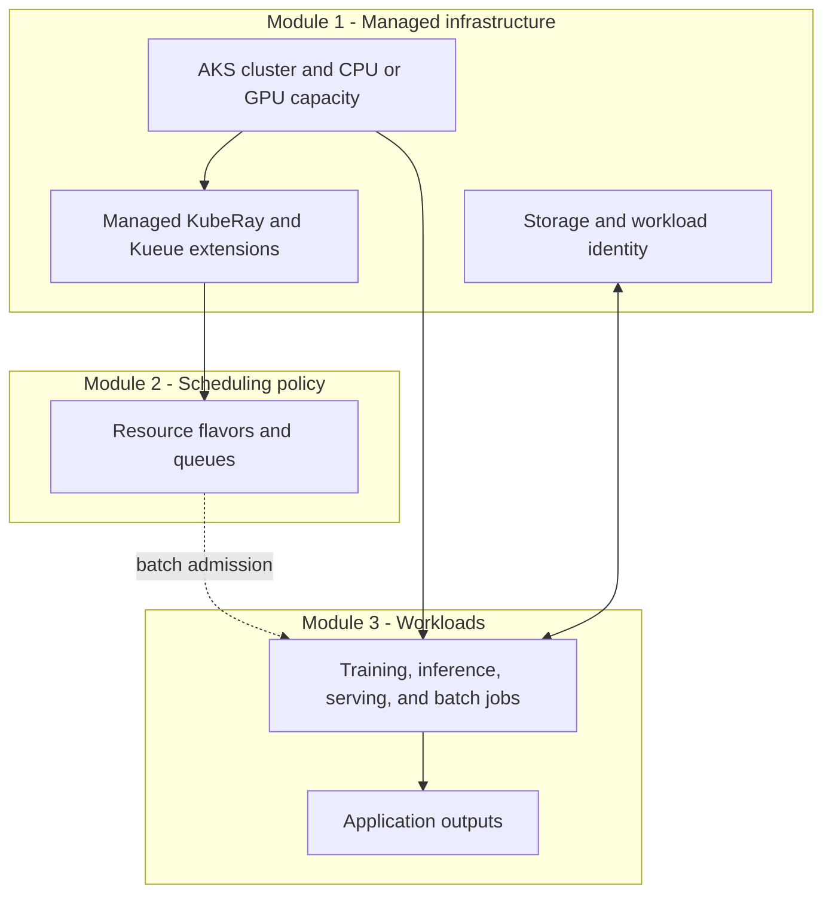

# Managed KubeRay and Kueue examples on AKS

Run training, inference, and serving on Azure Kubernetes Service with the
**managed KubeRay and Kueue extensions**. The extensions manage their supported
operators and APIs. You configure capacity, queue policies, application images,
storage, and workload identity for the workloads you choose.

## Start here

1. [Module 1 — Managed setup](1-infrastructure/managed/): prepare an AKS target,
   install the managed extensions, and configure workload dependencies.
2. [Module 2 — Queues](2-kueue-queues/): verify managed scheduling resources and
   configure your namespace, identity, and batch admission policy.
3. [Module 3 — Workloads](3-workloads/): submit a workload, monitor it, and verify
   its application output.

## Architecture

The three modules build one environment. Module 1 supplies the cluster platform
and workload dependencies. Module 2 configures placement and batch admission on
that platform. Module 3 runs workloads using those resources.



Individual guides explain the dependencies, admission behavior, and capacity
needed by each workload.

## Example selection

| Example | Resource | Capacity and dependencies |
| --- | --- | --- |
| [Aurora fine-tuning](3-workloads/aurora-finetune/) | RayJob | One A100, WeatherBench2 inputs, storage, and workload identity. |
| [LLM training](3-workloads/llm-training/) | RayJob | Four A100 workers, ViGGO data, storage, and workload identity. |
| [Batch inference](3-workloads/batch-inference/) | RayJob | One A100 and a completed LLM training adapter. |
| [Online serving](3-workloads/online-serving/) | RayService | One GPU and a completed Aurora checkpoint. |
| [CPU autoscaling](3-workloads/cas-batch-job/) | Job | Managed Kueue and an autoscaling CPU user pool. |

## Prerequisites and validation

Use the tools, permissions, and clean target described in
[Module 1 prerequisites](1-infrastructure/managed/#prerequisites). Don't install
these extensions alongside self-installed Kueue or KubeRay controllers.

Before submitting a workload:

1. Complete Module 1's extension, capacity, identity, and data checks required by
   that workload.
2. Complete Module 2's namespace and queue verification.
3. Validate the example files from this root directory (Python and GNU
   `envsubst` are required):

   ```bash
   python3 -m pip install -r 2-kueue-queues/tests/requirements.txt
   python3 -m unittest discover -s 1-infrastructure/managed/tests -v
   python3 -m unittest discover -s 2-kueue-queues/tests -v
   python3 -m unittest discover -s 3-workloads/tests -v
   ```

These offline contracts check the files and installation safety. They don't
replace the live readiness checks or prove that a model trained or served a
request. Verify the outputs described in each workload guide after execution.

## Managed quick start

From this example root, select the existing AKS target explicitly:

```bash
export EXAMPLES_DIR="$PWD"
export SUBSCRIPTION_ID="<subscription-id>"
export RESOURCE_GROUP="<resource-group>"
export CLUSTER_NAME="<existing-aks-cluster>"

cd "$EXAMPLES_DIR/1-infrastructure/managed"
./install-extensions.sh
source .managed/managed.env
```

Complete [Module 1 storage and identity setup](1-infrastructure/managed/#prepare-storage-and-workload-identity),
[dataset preparation](1-infrastructure/managed/data.md), and the recommended
[Module 2 queue setup](2-kueue-queues/#use-managed-ray-placement-flavors).
After those prerequisites pass, submit the selected workload. For example:

```bash
cd "$EXAMPLES_DIR/3-workloads/aurora-finetune"
export AZURE_STORAGE_ACCOUNT_NAME="<prepared-storage-account>"
source env.example
./submit.sh --dry-run
./submit.sh
kubectl --namespace ray get rayjobs,workloads,pods
```

A client dry run can still use API discovery. It doesn't prove successful
admission, storage authentication, training, inference, or serving.

## Cleanup

Clean up in this order:

1. Delete the workload and its ConfigMap using the selected
   [Module 3 workload guide](3-workloads/).
2. Remove only the queue policy you created using
   [Module 2 cleanup](2-kueue-queues/#clean-up).
3. Review the [Module 1 resource cleanup guidance](1-infrastructure/managed/#cleanup)
   before removing any storage, identity, node pools, or dedicated test cluster.

Keep shared clusters, managed defaults, and shared CRDs intact. Don't uninstall
extensions, clear finalizers, or rewrite ownership as a health workaround.
