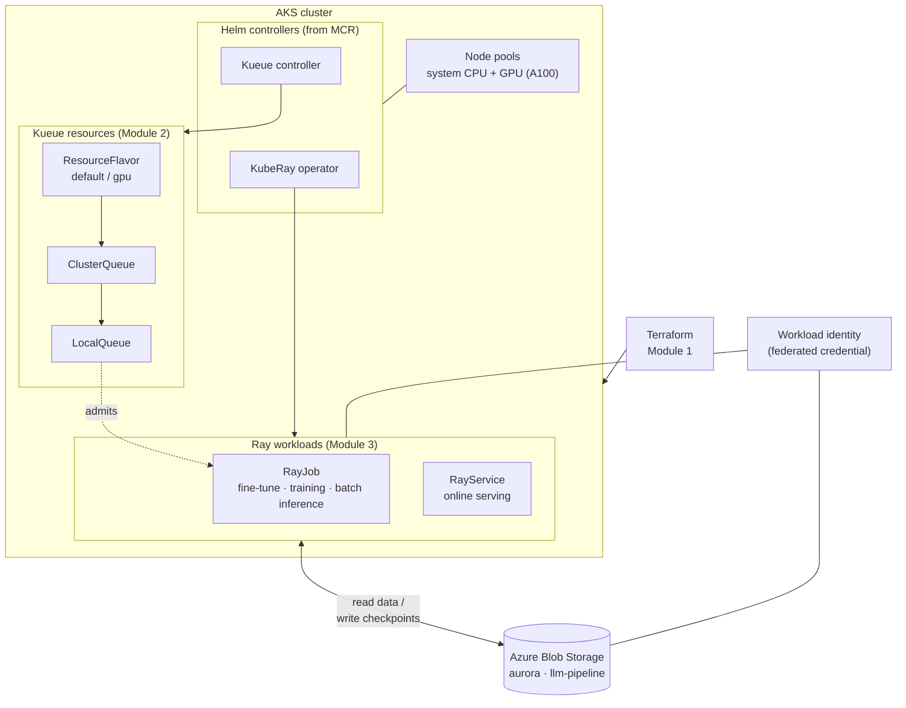

# Kueue and Ray on AKS

A hands-on walkthrough for running Ray training, inference, and serving on
Azure Kubernetes Service with Kueue admission control. Prefer the managed Kueue
path for an existing AKS cluster. A separate self-managed Terraform alternative
provisions a complete lab, including Helm-installed controllers.

## Overview

Sharing a GPU cluster across teams and jobs needs two things: something to
decide *which* workloads run *when*, and something to manage the distributed
runtime each workload depends on. This walkthrough uses Kueue for the first and
KubeRay for the second.

[Kueue](https://kueue.sigs.k8s.io/) is a Kubernetes-native job queueing
controller. Instead of letting every submitted job grab nodes immediately, you
define quotas (ResourceFlavors and ClusterQueues) and Kueue gates admission
against them — jobs that fit run, jobs that don't wait in line. This gives you
backpressure on a single constrained queue and fair borrowing between teams
that share a cohort, without anyone over-committing the cluster.

[KubeRay](https://github.com/ray-project/kuberay) manages the Ray lifecycle. A
`RayJob` spins up a Ray cluster, runs a batch workload (fine-tune, inference),
and tears it down; a `RayService` keeps a Ray Serve deployment running behind a
stable HTTP endpoint. Kueue and KubeRay integrate directly: a RayJob submitted
with `suspend: true` stays suspended until Kueue admits it.

AKS supplies the rest. GPU node pools (the default config provisions an A100
node), an OIDC issuer and workload identity so Ray pods reach Azure Blob Storage
without stored credentials, and the AI Runtime images and Helm charts served
from MCR. The three modules below provision that infrastructure, configure the
queues, and submit the workloads.

## Recommended: managed Kueue

Start with [Module 2 — Queues with managed Kueue](2-kueue-queues/) to install and
verify the Azure-managed extension on an AKS 1.34 or later cluster. For a CPU-only
end-to-end example, use its autoscale queue and the
[CPU batch Job](3-workloads/cas-batch-job/). That path doesn't need Terraform,
Ray, a GPU, storage, or workload identity.

For Ray workloads, also prepare KubeRay, storage, datasets, and workload identity
as described in Module 2. Supply Module 3 environment variables from those
resources instead of Terraform outputs.

> [!IMPORTANT]
> Module 1 Terraform installs Kueue through Helm. Don't apply it to a managed
> Kueue target or install the managed extension beside its controller. Keep the
> two installation paths separate. Preserve configuration and workload data
> before any planned uninstall; this walkthrough doesn't perform an in-place
> migration.

## Architecture

The following diagram describes the **self-managed Terraform alternative**, not
the managed extension installation path:



Terraform provisions the cluster and node pools, installs the KubeRay operator
and Kueue controller via Helm, and stages datasets in Azure Blob Storage.
Module 2 applies the Kueue quota objects. Module 3 submits Ray workloads
that read from and write to Blob Storage using workload identity — no access
keys in the manifests.

## Modules

| Module | Directory | What you'll do |
|--------|-----------|----------------|
| 1 — Infrastructure | [`1-infrastructure/`](1-infrastructure/) | Separate self-managed alternative: provision a lab with Helm-installed operators, storage, identity, and datasets. Don't combine with the managed installation. |
| 2 — Kueue Queues | [`2-kueue-queues/`](2-kueue-queues/) | Install and verify managed Kueue, then choose Ray queues or the CPU autoscale queue that references managed defaults. |
| 3 — Workloads | [`3-workloads/`](3-workloads/) | Submit Ray examples: Aurora fine-tune, LLM training, batch inference (RayJob), online serving (RayService), and a cluster-autoscaler batch Job |

For the managed path, start at Module 2 and provide its infrastructure
prerequisites separately. Work through Modules 1–3 in order only for the
self-managed Terraform alternative, using its single or team Ray queues.

The workloads in Module 3:

- **[Aurora fine-tune](3-workloads/aurora-finetune/)** — LoRA fine-tune of the Aurora weather model on regional ERA5 data (RayJob, 1×A100)
- **[LLM training](3-workloads/llm-training/)** — Distributed Qwen2.5-7B LoRA fine-tune with Ray Train and LLaMA-Factory (RayJob)
- **[Batch inference](3-workloads/batch-inference/)** — Parallel inference over a dataset using Ray Data and ActorPool (RayJob)
- **[Online serving](3-workloads/online-serving/)** — Aurora model served behind a stable HTTP endpoint with Ray Serve (RayService)
- **[CAS batch job](3-workloads/cas-batch-job/)** — a plain batch Job that provisions capacity on demand via a Kueue ProvisioningRequest driving the AKS cluster autoscaler

## Prerequisites

| Tool | Version | Notes |
|------|---------|-------|
| [Azure CLI](https://learn.microsoft.com/cli/azure/install-azure-cli) | ≥ 2.70 | Authenticated (`az login`) to the target subscription; GPU quota is needed only for GPU workloads. |
| [Terraform](https://developer.hashicorp.com/terraform/install) | ≥ 1.6 | Module 1 provisioning |
| [kubectl](https://kubernetes.io/docs/tasks/tools/) | Compatible with the target cluster | `az aks install-cli`; managed Kueue requires AKS 1.34 or later. |
| `envsubst` | — | Renders the Module 3 manifest templates (`gettext` package) |
| Python | ≥ 3.10 | Only for Aurora data generation in Module 1 |

You also need GPU quota in your target region. The default config provisions a
`Standard_ND96amsr_A100_v4` node (8×A100 80 GB) — check availability with
`az vm list-usage` before deploying, or set `gpu_enabled=false` for a CPU-only
run. See [Module 1](1-infrastructure/) for details.

## Self-managed Terraform alternative: Aurora fine-tune

This alternative provisions Helm-installed controllers, not the managed Kueue
extension. It remains separate from the recommended managed path. Provision the
lab, point kubectl at it, apply the single Ray queue, and submit one RayJob.

> **CPU-only note:** If you deployed with `gpu_enabled=false`, the Module 3
> workloads request `nvidia.com/gpu` and will stay Pending (no GPU nodes).
> The CPU-only path is useful for validating infrastructure and queue
> configuration (Modules 1–2); skip the workload submission step below.

```bash
# 1. Provision infrastructure (Module 1)
cd 1-infrastructure/terraform
terraform init
terraform apply -var="subscription_id=<your-subscription-id>"

# 2. Point kubectl at the new cluster
eval "$(terraform output -raw get_credentials_command)"

# 3. Configure Kueue (Module 2) — namespace, identity, flavors, single queue
cd ../../2-kueue-queues
kubectl apply -f manifests/00-namespace.yaml
kubectl apply -f <(terraform -chdir=../1-infrastructure/terraform output -raw ray_workload_sa_yaml)
kubectl apply -f manifests/10-resource-flavors.yaml
kubectl apply -f manifests/20-single-queue.yaml

# 4. Submit one RayJob (Module 3 — Aurora fine-tune)
cd ../3-workloads/aurora-finetune
source env.example
export AZURE_STORAGE_ACCOUNT_NAME=$(terraform -chdir=../../1-infrastructure/terraform output -raw storage_account_name)
./submit.sh

# 5. Verify it gets admitted and runs
kubectl -n ray get rayjob,pods -w
```

The RayJob stays suspended until Kueue admits it from the `default` queue, then
KubeRay brings up the Ray cluster and runs the workload. For other examples and
the team-queue borrowing demo, follow each module's README.

## Cleanup

For the managed path, use the demo-specific cleanup in Module 2 and keep the
managed defaults. Uninstalling the extension is a separate destructive operation.

For the self-managed Terraform lab below, delete workloads and queue objects,
then tear down its Azure resources:

```bash
# Return to the example root (Quick start leaves you in 3-workloads/aurora-finetune)
cd ../../

# Remove queues and namespace (optional — terraform destroy removes the cluster anyway)
kubectl delete namespace ray

# Tear down the cluster, operators, storage, and identity
cd 1-infrastructure/terraform
terraform destroy -var="subscription_id=<your-subscription-id>"
```
