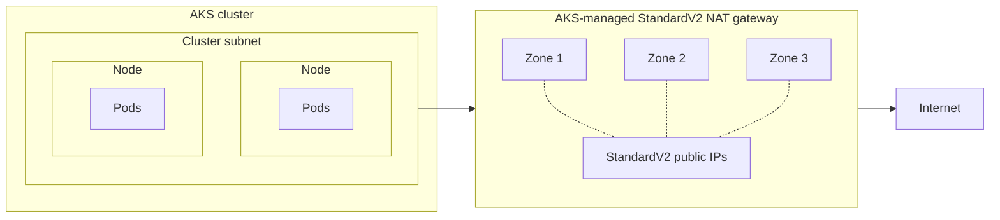

StandardV2 NAT Gateway support for AKS-managed egress is now generally available. On API version `2026-06-01` and later, AKS provisions and manages a StandardV2 NAT gateway for new clusters that use the `managedNATGateway` outbound type, in every region where the SKU is available, and a Standard NAT gateway everywhere else.

The StandardV2 NAT gateway is zone redundant by default and supports double the throughput and packets per second compared to Standard SKU. You keep the fully managed experience, and you choose who owns the outbound public IP resources: let Azure create and manage them, or attach your own pre-provisioned StandardV2 public IP addresses and prefixes.

Existing clusters keep the Standard NAT gateway they already have until you migrate them.

<!-- truncate -->

## Why NAT Gateway for AKS egress?

AKS nodes need outbound connectivity to reach the API server, pull images, and receive security updates, and your workloads add their own dependencies on top. Connections that leave over the public internet each consume a source network address translation (SNAT) port, and as concurrency grows, insufficient SNAT capacity surfaces as intermittent failures and timeouts that are time-consuming to diagnose.

Azure NAT Gateway provides SNAT at the subnet level and hands out ports on demand rather than reserving a fixed block per node, which uses the available pool far more efficiently. For the mechanics, including per-address port counts and scaling limits, see [Azure NAT Gateway resources](https://learn.microsoft.com/azure/nat-gateway/nat-gateway-resource).

Traffic that stays on the Azure backbone doesn't consume SNAT ports at all, so a private cluster's API server traffic and anything behind private or service endpoints never touches the NAT gateway. Size egress capacity against your public-internet dependencies, including the [required AKS outbound network rules and FQDNs](https://learn.microsoft.com/azure/aks/outbound-rules-control-egress).

## What StandardV2 NAT Gateway adds

| Capability | Standard | StandardV2 |
| --- | --- | --- |
| Availability zones | Single zone | Zone redundant |
| Throughput per NAT gateway | Up to 50 Gbps | Up to 100 Gbps |
| IPv6 outbound addresses | Not supported | Supported |
| Required public IP SKU | Standard | [StandardV2](https://learn.microsoft.com/azure/virtual-network/ip-services/public-ip-addresses#sku), always zone redundant and not interchangeable with Standard |

Zone redundancy is a key enhancement of the StandardV2 NAT gateway. A Standard NAT gateway operates out of a single availability zone, so a zone-level disruption can impact your cluster's egress traffic. A StandardV2 NAT gateway spans every availability zone in the region, so new outbound connections continue to flow through the healthy zones.

The higher throughput ceiling matters for data-heavy clusters that push large volumes to object storage, model registries, or partner endpoints. IPv6 support lets dual-stack clusters use the same managed egress path for both address families.



For a full SKU comparison, see the [Azure NAT Gateway SKU documentation](https://learn.microsoft.com/azure/nat-gateway/nat-sku).

## How the GA API models the StandardV2 SKU

The generally available API expresses the SKU as a property of the existing outbound type rather than as a new outbound type. Starting with API version `2026-06-01`, newly deployed clusters with `outboundType` set to `managedNATGateway` will default `networkProfile.natGatewayProfile.sku` to `StandardV2` in regions where StandardV2 NAT gateway is available. Otherwise, it will set `sku` to `Standard`. To migrate existing clusters with Standard NAT gateway, update the cluster with `sku` set to `StandardV2` on API version `2026-06-01` or later.

```json
{
  "outboundType": "managedNATGateway",
  "natGatewayProfile": {
    "sku": "StandardV2"
  }
}
```

AKS validates that value against the region, which results in the following behavior:

- **Omit `sku`** and AKS picks the regional default: StandardV2 where it's available, Standard everywhere else. Use this when the same template deploys to many regions.
- **Set `sku` explicitly** and the request has to match what the region supports. Asking for `StandardV2` where it isn't available fails with `UnsupportedOutboundType`.

Existing clusters are unaffected until you act on them. A cluster already running a Standard NAT gateway keeps it, and a request on an earlier API version keeps the previous Standard behavior.

> **Note**: If you used the public preview, the GA API doesn't expose `managedNATGatewayV2` as an outbound type. Preview API versions `2026-01-02-preview` through `2026-05-02-preview` continue to accept `managedNATGatewayV2` until they reach their documented retirement dates, which gives you time to move to `managedNATGateway` with an explicit `sku`. For those dates, see the [AKS Preview API life cycle documentation](https://learn.microsoft.com/azure/aks/concepts-preview-api-life-cycle).

## Choose who owns the outbound IP addresses

The NAT gateway profile also determines where the outbound public IP resources come from. Pick one of the two models below when you create the cluster. You can't combine them, and you can't switch between them for as long as the cluster stays on its current SKU, although you can still adjust counts, addresses, and idle timeout within the model you chose.

### Let Azure manage the outbound IPs

Use `managedOutboundIPProfile` when you want the lowest operational overhead. Each count accepts a value from 1 through 16, and if you omit the IPv4 count, AKS creates one address.

```json
"natGatewayProfile": {
  "sku": "StandardV2",
  "managedOutboundIPProfile": { "count": 2, "countIPv6": 1 },
  "idleTimeoutInMinutes": 30
}
```

Requesting IPv6 addresses requires a dual-stack cluster, which you configure with [Azure CNI Overlay dual-stack networking](https://learn.microsoft.com/azure/aks/azure-cni-overlay#about-azure-cni-overlay-aks-clusters-with-dual-stack-networking).

### Bring your own StandardV2 public IPs

Use `outboundIPs`, `outboundIPPrefixes`, or both when downstream systems need to allowlist known, pre-provisioned egress addresses. Create the resources first with the StandardV2 SKU using [az network public-ip create](https://learn.microsoft.com/cli/azure/network/public-ip#az-network-public-ip-create), then reference their resource IDs:

```json
"natGatewayProfile": {
  "sku": "StandardV2",
  "outboundIPs": { "publicIPs": ["<public-ip-resource-id>"] },
  "outboundIPPrefixes": { "publicIPPrefixes": ["<public-ip-prefix-resource-id>"] },
  "idleTimeoutInMinutes": 30
}
```

These resources stay under your control even though AKS manages the NAT gateway itself, and they can carry IPv4 or IPv6 addresses.

> **Note**: Moving to a StandardV2 NAT gateway doesn't move your whole cluster to StandardV2 public IPs. The requirement applies only to NAT gateway egress. Inbound traffic to `type: LoadBalancer` Services still flows through the AKS-managed Standard load balancer, which needs Standard public IPs. If you pre-provision public IP inventory, order both SKUs: StandardV2 for NAT gateway egress and Standard for inbound Services.

## Create the cluster

With Azure CLI 2.91.0 or later, set `--outbound-type managedNATGateway`. The SKU defaults to `StandardV2` in a supported region:

```bash
az aks create \
  --resource-group "$RESOURCE_GROUP" \
  --name "$CLUSTER_NAME" \
  --location "$LOCATION" \
  --outbound-type managedNATGateway \
  --nat-gateway-managed-outbound-ip-count 2 \
  --nat-gateway-idle-timeout 30 \
  --generate-ssh-keys
```

On a dual-stack cluster, add `--nat-gateway-managed-outbound-ipv6-count` to request Azure-managed IPv6 addresses as well. That flag requires the StandardV2 SKU.

To bring your own addresses instead, swap the managed counts for your pre-provisioned StandardV2 resource IDs. Supply IPv6 addresses or prefixes here too if the cluster is dual-stack, rather than mixing in the managed count flags, which belong to the other ownership model:

```bash
az aks create \
  --resource-group "$RESOURCE_GROUP" \
  --name "$CLUSTER_NAME" \
  --location "$LOCATION" \
  --outbound-type managedNATGateway \
  --outbound-type-sku StandardV2 \
  --nat-gateway-outbound-ips "$PUBLIC_IP_ID" \
  --nat-gateway-outbound-ip-prefixes "$PUBLIC_IP_PREFIX_ID" \
  --nat-gateway-idle-timeout 30 \
  --generate-ssh-keys
```

The second example names the SKU explicitly, so it only succeeds where the StandardV2 NAT gateway is available; omitting `--outbound-type-sku` takes the regional default instead. Two things to get right when bringing your own addresses: keep the cluster in the same region as those IP resources, since a NAT gateway can only attach public IPs from its own region and `az aks create` falls back to the resource group's location when you omit `--location`. And if the addresses live outside the cluster's node resource group, the cluster identity needs permission to attach them, which [Use a managed identity in AKS](https://learn.microsoft.com/azure/aks/use-managed-identity) covers.

If you deploy through Azure Resource Manager directly, send the same `natGatewayProfile` inside a full managed cluster definition on API version `2026-06-01`.

## Confirm the deployment

`effectiveOutboundIPs` is read only. AKS populates it after provisioning, so leave it out of create and update requests. Note that it returns Azure Resource Manager resource references, not literal addresses, so resolve them before you put anything into a downstream allowlist:

```bash
URL="https://management.azure.com/subscriptions/${SUBSCRIPTION_ID}/resourceGroups/${RESOURCE_GROUP}/providers/Microsoft.ContainerService/managedClusters/${CLUSTER_NAME}?api-version=2026-06-01"

az rest --method get --url "$URL" \
  --query 'properties.networkProfile.natGatewayProfile.effectiveOutboundIPs[].id' \
  --output tsv
```

Resolve each address reference with `az network public-ip show --ids <id> --query ipAddress` and each prefix reference with `az network public-ip prefix show --ids <id> --query ipPrefix`. Addresses resolve to a single IP and prefixes to a CIDR range, so allowlist whichever form each entry produces.

To confirm the data path end to end, point `kubectl` at the new cluster with `az aks get-credentials` and run a short-lived pod that reports its public source address:

```bash
kubectl run natv2-egress-check --image=curlimages/curl:8.12.1 \
  --restart=Never --rm --stdin \
  --command -- curl --fail --silent --show-error https://api.ipify.org
```

The address it returns should match one of the resolved addresses, or fall inside one of the resolved prefix ranges. On a dual-stack cluster, repeat the check with `curl --ipv6` against `https://api6.ipify.org`, because `api.ipify.org` answers over IPv4 only. Then test the outbound paths your applications actually depend on, including container registries, Azure APIs, and allowlisted partner services.

Ongoing monitoring needs no special setup. Existing Azure NAT Gateway metrics, alerts, and dashboards apply unchanged, so your current SNAT monitoring continues to work against a StandardV2 NAT gateway.

## Move an existing cluster to a StandardV2 NAT gateway

Existing clusters stay on Standard until you ask for the change. Pass the new SKU to `az aks update`, where `--outbound-type` can be omitted because the cluster already uses `managedNATGateway`:

```bash
az aks update \
  --resource-group "$RESOURCE_GROUP" \
  --name "$CLUSTER_NAME" \
  --outbound-type-sku StandardV2
```

Plan this as a replacement rather than an upgrade, because that's what happens underneath: AKS removes the Standard NAT gateway and provisions a StandardV2 one in its place, reusing the same resource name.

> **Warning**: Your egress IP addresses change during this migration. A StandardV2 NAT gateway requires StandardV2 public IP resources, so your existing Standard public IPs can't carry over. Expect existing outbound connections to reset as the NAT gateway is swapped.

The command above keeps Azure-managed outbound IPs, and those addresses don't exist until the update creates them, so you can't allowlist them in advance. Plan a maintenance window: run the update, resolve the new `effectiveOutboundIPs` references, update downstream systems, then resume production traffic.

To switch to your own StandardV2 addresses at the same time, pre-provision and allowlist them first, then use a REST update on API version `2026-06-01` or later that sets `sku` to `StandardV2`, supplies `outboundIPs` or `outboundIPPrefixes`, and omits `managedOutboundIPProfile`. Both changes must happen in the same update, because the ownership model is fixed once the cluster is on StandardV2. Don't use the customer-IP CLI flags here in Azure CLI 2.91.0; they retain the existing managed profile and combine mutually exclusive configurations.

Migrating from `loadBalancer` outbound connectivity is supported too, with the same address-change planning. For outbound-type concepts, user-assigned NAT gateway scenarios, and the full `natGatewayProfile` schema, see the [AKS NAT gateway documentation](https://learn.microsoft.com/azure/aks/nat-gateway).

## Limitations to plan for

| Limitation | What it means for your cluster |
| --- | --- |
| StandardV2 public IP SKU is required | Standard public IP addresses and prefixes aren't compatible with a StandardV2 NAT gateway. |
| Custom IP prefixes aren't supported | If you bring your own IP ranges through Azure Custom IP Prefix, a StandardV2 NAT gateway isn't an option today. |
| The outbound IP ownership model is fixed per SKU | Choose between Azure-managed and customer-defined addresses at creation, or at the point you migrate the SKU. |
| Regional availability varies | Check the [StandardV2 regional limitations](https://learn.microsoft.com/azure/nat-gateway/nat-overview#key-limitations-of-standardv2) for your region instead of assuming parity across the fleet. |
| Azure quotas still apply | Public IP and subscription limits constrain how far you can scale outbound addresses. |
| The SKU change is one way | You can move from Standard to StandardV2, but you can't downgrade back to Standard. |

Dual-stack clusters have one extra design point. `outboundType` is a single cluster-wide setting that governs IPv4 and IPv6 together, so you can't route one address family through a NAT gateway and the other through load balancer outbound rules. That makes the StandardV2 NAT gateway the only managed NAT gateway option for dual-stack egress, because the Standard SKU handles IPv4 only. If you'd rather keep both families on load balancer outbound rules, choose `loadBalancer` as the outbound type instead.

For traffic whose next hop is the internet, the NAT gateway takes precedence over load balancer outbound rules, instance-level public IPs, and Azure Firewall, so connections that previously used those paths may be interrupted when it attaches. A user-defined route is the exception: traffic doesn't pass through the NAT gateway at all when a route sends `0.0.0.0/0` to a network virtual appliance or a virtual network gateway.

## Get started

A StandardV2 NAT gateway gives AKS-managed egress a zone-redundant foundation, higher throughput and bandwidth, and a choice between hands-off and fully controlled outbound addressing. New clusters in supported regions pick it up automatically on API version `2026-06-01`, and existing clusters move when you're ready.

Try it on a nonproduction cluster first, confirm the effective outbound IPs, and validate the egress paths your applications depend on. To go deeper:

- [Create a managed or user-assigned NAT gateway for AKS](https://learn.microsoft.com/azure/aks/nat-gateway)
- [Customize AKS cluster egress with outbound types](https://learn.microsoft.com/azure/aks/egress-outboundtype)
- [Review required AKS outbound network rules and FQDNs](https://learn.microsoft.com/azure/aks/outbound-rules-control-egress)
- [Understand Azure NAT Gateway resources and SKUs](https://learn.microsoft.com/azure/nat-gateway/nat-gateway-resource)
- [Track AKS regional releases](https://releases.aks.azure.com/AKSRelease)

Tell us how it goes. Report issues or suggest improvements through the [AKS GitHub repository](https://github.com/Azure/AKS/issues).
