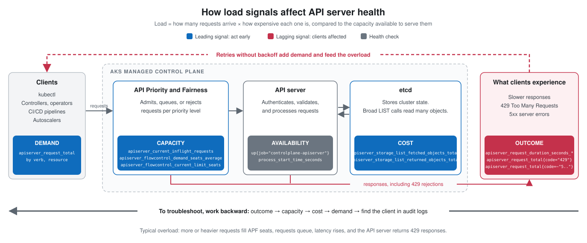

We're excited to announce the general availability of **control plane metrics for Azure Kubernetes Service (AKS)**, built on [Azure Monitor managed service for Prometheus](https://learn.microsoft.com/azure/azure-monitor/metrics/prometheus-metrics-overview). With this release, customers gain deeper visibility into the health and performance of the AKS control plane, helping them operate Kubernetes with greater confidence at scale. Control plane metrics collect API server and etcd metrics by default, with optional support for kube-scheduler, kube-controller-manager, Cluster Autoscaler, and node auto-provisioning, so platform teams can detect issues earlier, troubleshoot faster, and keep critical applications running smoothly.

If you enabled control plane metrics during the preview, metrics continue to flow with no action required. For other clusters, follow the setup steps below. This post also shows how to keep your API server healthy: which signals to watch, how they connect, and how to find and fix the client behind the load.

<!-- truncate -->

## Why control plane visibility matters

AKS manages control plane patching, high availability, and infrastructure health for you. But even a fully managed control plane responds to the load your cluster puts on it. A busy API server or an etcd database nearing its storage quota can show up as stalled deployments, request timeouts, or delayed autoscaling, and it's hard to tell where the problem starts.

Control plane metrics make key signals queryable in your own Azure Monitor workspace, so you can investigate these symptoms yourself:

- **Faster investigation**: Check whether control plane pressure is behind slow deployments or request timeouts.
- **Proactive monitoring**: Alert on sustained latency, throttling, and errors before they cause wider impact.
- **Self-serve diagnostics**: Answer common questions with PromQL and the built-in dashboards instead of opening a support case.

Metrics show *where* pressure is building. To find *which* client is causing it, see [Find the client behind the load](#find-the-client-behind-the-load).

## Enable control plane metrics

Control plane collection uses the Azure Monitor managed service for Prometheus (the Azure Monitor Metrics add-on) and stores Prometheus data in an Azure Monitor workspace. The cluster must use managed identity authentication; see the AKS [managed identity guidance](https://learn.microsoft.com/azure/aks/use-managed-identity).

For a **new cluster**, enable the add-on and control plane collection together:

```bash
az aks create \
  --name $CLUSTER_NAME \
  --resource-group $RESOURCE_GROUP \
  --enable-azure-monitor-metrics \
  --enable-control-plane-metrics
```

For an **existing cluster that already has the managed Prometheus add-on**:

```bash
az aks update \
  --name $CLUSTER_NAME \
  --resource-group $RESOURCE_GROUP \
  --enable-control-plane-metrics
```

If your existing cluster doesn't yet have the add-on, first enable it and configure an Azure Monitor workspace by following [Enable monitoring for AKS clusters](https://learn.microsoft.com/azure/azure-monitor/containers/kubernetes-monitoring-enable). For the exact prerequisites and other deployment options, see [Monitor AKS control plane metrics](https://learn.microsoft.com/azure/aks/control-plane-metrics-monitor).

To visualize these metrics, open the built-in API server and etcd dashboards in the Azure portal through [Dashboards with Grafana](https://learn.microsoft.com/azure/azure-monitor/visualize/grafana-kubernetes). To use your own Azure Managed Grafana instance instead, see [Add an Azure Monitor workspace to Azure Managed Grafana](https://learn.microsoft.com/azure/managed-grafana/how-to-connect-azure-monitor-workspace).

## Tune your targets and ingestion settings

The API server (`apiserver`) and etcd are collected by default. You can optionally enable `kube-scheduler`, `kube-controller-manager`, `cluster-autoscaler`, and `node-auto-provisioning`, depending on your cluster configuration.

You customize collection with the `ama-metrics-settings-configmap` in the `kube-system` namespace. The ConfigMap might not exist by default, so start from the [current version on Microsoft Learn](https://learn.microsoft.com/azure/azure-monitor/containers/prometheus-metrics-scrape-configuration). Here's the schema v2 control plane section:

```yaml
apiVersion: v1
kind: ConfigMap
metadata:
  name: ama-metrics-settings-configmap
  namespace: kube-system
data:
  schema-version: v2
  controlplane-metrics: |-
    default-targets-scrape-enabled: |-
      apiserver = true
      etcd = true
      kube-scheduler = false
      kube-controller-manager = false
      cluster-autoscaler = false
      node-auto-provisioning = false
    minimal-ingestion-profile: |-
      enabled = true
```

The **minimal ingestion profile is enabled by default** and limits ingestion to the curated metrics used by the default dashboards, recording rules, and alerts. Keep it enabled, and when you need more metrics, add a target-specific keep list instead of disabling the profile, which can significantly increase ingestion volume and cost. ConfigMap changes can take several minutes to appear in the workspace. For the full target list and schema, see [Customize control plane metrics](https://learn.microsoft.com/azure/aks/control-plane-metrics-monitor#customize-control-plane-metrics).

## Start with the API server

The API server is the front door to Kubernetes. Every interaction with your cluster flows through it, including `kubectl`, controllers and operators, CI/CD pipelines, autoscalers, admission webhooks, and in-cluster automation. When the API server is under pressure, the impact ripples across the entire cluster: deployments stall, pod scheduling slows, and controllers fall behind.

For production clusters, it's not enough to know that the API server is running. The real question is whether it's keeping up with demand and serving requests without sustained latency, throttling, or errors.

To help you get started, the [built-in API server and etcd dashboards](https://learn.microsoft.com/azure/azure-monitor/visualize/grafana-kubernetes) visualize many of these signals.

### Recommended signals to monitor

We recommend focusing on the following signals when assessing API server health.

| Signal | Example metrics | What it tells you |
| --- | --- | --- |
| **Availability and restarts** | `up{job="controlplane-apiserver"}`, `process_start_time_seconds{job="controlplane-apiserver"}` | Whether the API server is reachable and whether it has restarted |
| **Errors and throttling** | `apiserver_request_total{code="429"}`, `apiserver_request_total{code=~"5.."}` | Requests that were throttled (429) or failed (5xx) |
| **Request latency** | `apiserver_request_duration_seconds_bucket`, `apiserver_request_duration_seconds_sum`, `apiserver_request_duration_seconds_count` | Average latency, or percentiles when full histogram buckets are retained |
| **In-flight requests** | `apiserver_current_inflight_requests` | How many requests the API server is processing right now |
| **APF demand vs. capacity** | `apiserver_flowcontrol_demand_seats_average`, `apiserver_flowcontrol_current_limit_seats` | Requested concurrency compared to the available limit for each priority level |
| **LIST object fan-out** | `apiserver_storage_list_fetched_objects_total`, `apiserver_storage_list_returned_objects_total` | How many objects LIST calls fetch from storage compared to how many they return |
| **Request volume and mix** | `apiserver_request_total` | API request rate and how the mix of verbs and resources changes over time |

> **Note**: A metric appears in your workspace only if its target is enabled and your ingestion profile or keep list retains it. Request labels such as verb and resource describe traffic patterns but don't identify the client sending the requests.

### How the signals connect

API server load depends on three things: how many requests arrive (demand), how expensive each request is (cost), and how much concurrency is available to serve them (capacity). When demand multiplied by cost exceeds capacity, clients see the outcome as higher latency, `429` responses, or errors.

[](./api-server-signals.svg)

*Select the diagram to open it full size.*

Demand, cost, and capacity signals are leading indicators, so they let you act before clients are affected. Latency, `429` responses, and `5xx` errors are lagging indicators that tell you clients are already affected. Clients that retry without backoff add demand and make the overload worse.

When you troubleshoot, work backward from what clients experience. The following sections follow that order: confirm the API server is available, check errors and latency, see whether APF capacity is saturated, look for expensive `LIST` calls, and identify which verbs and resources drive demand. When several signals point the same way, such as rising latency, APF pressure, and sustained `429` responses, [find the client behind the load](#find-the-client-behind-the-load).

Here's a closer look at each signal, what it tells you, and how to query it. Every cluster has a different normal, so establish a baseline for each production cluster and watch for sustained deviations from it rather than applying universal thresholds.

> **Tip**: If multiple clusters share an Azure Monitor workspace, keep the `cluster` label in your aggregations so baselines and alerts stay separate. Use a matcher such as `{cluster="your-cluster"}` to query a single cluster, and make sure each cluster has a distinct [cluster alias](https://learn.microsoft.com/azure/azure-monitor/containers/prometheus-metrics-scrape-configuration#cluster-alias).

### 1. Availability and restarts

Basic availability and restart detection remain an essential foundation for monitoring:

```promql
# API server target is reachable (1 = up, 0 = down)
up{job="controlplane-apiserver"}

# API server process start time (changes when the process restarts)
process_start_time_seconds{job="controlplane-apiserver"}

# Number of API server restarts in the last hour
changes(process_start_time_seconds{job="controlplane-apiserver"}[1h])
```

**Recommendation:** Don't rely on availability alone. An API server can report as `up` while being too overloaded to respond effectively. Availability confirms that the API server is reachable, while latency, APF pressure, errors, and `LIST` behavior confirm that it's *healthy*.

### 2. Errors and throttling

Sustained `429` (Too Many Requests) and `5xx` (server error) responses are among the clearest signs that the control plane is under pressure.

```promql
# Throttled requests per second
sum by (cluster) (rate(apiserver_request_total{code="429"}[5m]))

# Percentage of requests throttled
100 * sum by (cluster) (rate(apiserver_request_total{code="429"}[5m]))
    / sum by (cluster) (rate(apiserver_request_total[5m]))

# Server errors by response code
sum by (cluster, code) (rate(apiserver_request_total{code=~"5.."}[5m]))
```

Use the following guidance to interpret what you see:

- **Healthy:** `429` and `5xx` responses are absent or isolated.
- **Warning:** Intermittent `429` responses appear during traffic bursts.
- **Investigate:** `429` responses are sustained, or `500`/`503` responses appear alongside rising latency.

**Recommendation:** Require errors to persist for a short window before paging. This filters out isolated, transient failures and keeps your alerts focused on real issues.

### 3. Request latency

Latency is one of the most customer-visible indicators of control plane health. Always compare it with request volume and response codes, because `LIST` operations can be significantly more expensive than a typical `GET` or `UPDATE`.

The minimal ingestion profile retains the latency `_sum` and `_count` series, so you can calculate average latency right away:

```promql
# Average API server request latency (seconds)
sum by (cluster) (rate(apiserver_request_duration_seconds_sum[5m]))
  / sum by (cluster) (rate(apiserver_request_duration_seconds_count[5m]))
```

#### Enable latency percentiles

The [default configuration](https://learn.microsoft.com/azure/azure-monitor/containers/prometheus-metrics-scrape-default) retains only the `le="+Inf"` latency bucket. That's enough for average latency, but not percentiles. To use `histogram_quantile`, retain the full histogram by adding the following keep list to the `controlplane-metrics` section of your `ama-metrics-settings-configmap`:

```yaml
data:
  controlplane-metrics: |-
    default-targets-metrics-keep-list: |-
      apiserver = "apiserver_request_duration_seconds_bucket|apiserver_request_duration_seconds_sum|apiserver_request_duration_seconds_count"
```

Then apply the complete ConfigMap:

```bash
kubectl apply -f configmap-controlplane.yaml
```

After a few minutes, verify that the finite bucket boundaries and `+Inf` appear in your workspace. For other metrics, see [Customize an ingestion profile](https://learn.microsoft.com/azure/aks/control-plane-metrics-monitor#customize-an-ingestion-profile). You can then track tail latency:

```promql
# p99 API server request latency by verb (seconds)
histogram_quantile(0.99,
  sum by (cluster, verb, le) (rate(apiserver_request_duration_seconds_bucket[5m])))
```

**Recommendation:** Latency that stays elevated across multiple evaluation intervals, especially alongside APF pressure, growing in-flight requests, or errors, can indicate control plane pressure.

### 4. In-flight requests

In-flight requests show how many requests the API server is processing at any moment. This metric is often the earliest warning sign of pressure, rising before latency or errors do.

```promql
# Current in-flight requests by type (read-only vs. mutating)
sum by (cluster, request_kind) (apiserver_current_inflight_requests)
```

In a healthy cluster, in-flight requests spike during traffic bursts and quickly return to baseline. When they stay elevated, the API server isn't keeping up with demand.

**Recommendation:** Watch for in-flight requests that stay elevated across multiple intervals, especially when APF seat demand and latency rise at the same time.

### 5. API Priority and Fairness (APF) demand vs. capacity

[API Priority and Fairness (APF)](https://kubernetes.io/docs/concepts/cluster-administration/flow-control/) protects the API server by controlling how concurrency is shared across different classes of API traffic. Two metrics help you see whether a priority level is running out of room:

- **Demand seats:** The concurrency a priority level is requesting.
- **Limit seats:** The concurrency currently available to that priority level.

Plot demand and limit side by side for each priority level, and use the ratio between them to spot contention:

```promql
# Seats requested by each priority level
sum by (cluster, priority_level) (apiserver_flowcontrol_demand_seats_average)

# Seats available to each priority level
sum by (cluster, priority_level) (apiserver_flowcontrol_current_limit_seats)

# Demand-to-limit ratio (values near 1 indicate contention)
sum by (cluster, priority_level) (apiserver_flowcontrol_demand_seats_average)
  / sum by (cluster, priority_level) (apiserver_flowcontrol_current_limit_seats)
```

**Recommendation:** Watch for priority levels where demand stays close to the limit over time. When this happens, APF may queue requests, and `429` responses can occur if requests are rejected or time out. However, demand reaching the limit doesn't by itself mean requests were rejected, so correlate seat metrics with response codes and latency before drawing conclusions.

### 6. LIST object fan-out

Request rate tells you how many `LIST` calls the API server receives, but not how much work each one requires. These metrics show how many objects the API server fetched from storage compared to how many it actually returned, which makes them especially useful for large AKS clusters:

```promql
# Objects fetched from storage by LIST calls, per resource
sum by (cluster, resource) (rate(apiserver_storage_list_fetched_objects_total[5m]))

# Objects returned to clients by LIST calls, per resource
sum by (cluster, resource) (rate(apiserver_storage_list_returned_objects_total[5m]))

# Fetched-to-returned ratio (higher values mean more filtering per LIST)
sum by (cluster, resource) (rate(apiserver_storage_list_fetched_objects_total[5m]))
  / sum by (cluster, resource) (rate(apiserver_storage_list_returned_objects_total[5m]))
```

**Recommendation:** A large gap between fetched and returned objects means the API server read far more from storage than it returned. For large clusters, this is a useful clue. To find which client is issuing those `LIST` calls, see [Find the client behind the load](#find-the-client-behind-the-load).

### 7. Request volume and mix

Finally, look at the total volume of traffic reaching the API server, and break it down by verb to see which kinds of requests drive the change.

```promql
# Total request rate per cluster
sum by (cluster) (rate(apiserver_request_total[5m]))

# Request rate by verb
sum by (cluster, verb) (rate(apiserver_request_total[5m]))
```

Pay close attention to `LIST`, `GET`, `WATCH`, `PATCH`, `UPDATE`, and `CREATE` requests. High request volume on its own isn't a warning sign, since large clusters naturally generate significant traffic. The pattern to watch for is request volume that grows alongside rising latency, APF pressure, or errors. Verb and resource labels describe what kind of traffic is arriving; to see which client is sending it, see [Find the client behind the load](#find-the-client-behind-the-load).

**Recommendation:** Investigate sustained growth, especially when it's driven by `LIST`, `WATCH`, `PATCH`, or `UPDATE` requests.

## Find the client behind the load

Control plane metrics tell you *what* is happening, but not *who* is causing it. To identify the client, use AKS [control plane resource logs](https://learn.microsoft.com/azure/aks/monitor-aks#aks-control-plane-resource-logs), which record the user agent, identity, verb, and response code for each API request.

Enable the audit log categories through a diagnostic setting that sends data to a Log Analytics workspace in resource-specific mode:

- **`kube-audit-admin`** (`AKSAuditAdmin` table): Captures mutating requests such as `create`, `update`, `patch`, and `delete`, but excludes `get` and `list`. It's lower cost and suitable to keep on continuously.
- **`kube-audit`** (`AKSAudit` table): Captures all requests, including `get` and `list`. Enable it when you need to attribute `LIST` traffic or `429` responses, and consider disabling it afterward, because it can generate significant log volume.

Then query for the clients that generate the most requests or the most throttled responses:

```kusto
// Top user agents by request volume and throttled responses
AKSAudit
| where TimeGenerated > ago(1h)
| extend Code = toint(ResponseStatus.code)
| summarize Requests = count(), Throttled = countif(Code == 429) by UserAgent, Verb
| top 10 by Requests desc
```

Look for a single controller, operator, or CI/CD tool that dominates request volume, issues frequent unscoped `LIST` calls, or receives most of the `429` responses. Once you've identified it, check its retry, polling, and watch behavior. For more queries and mitigation steps, see [Identify unoptimized clients](https://learn.microsoft.com/troubleshoot/azure/azure-kubernetes/create-upgrade-delete/troubleshoot-apiserver-etcd#step-1-identify-unoptimized-clients) in the AKS troubleshooting guide.

## Common fixes

Once you've identified the source of the pressure, these changes resolve most API server load issues:

- **Scope your `LIST` calls.** Avoid cluster-wide `LIST` calls without filters, especially in large clusters. Add label or field selectors to restrict results to the objects you need, and use the `limit` and `continue` parameters to paginate large result sets. See [Efficient Kubernetes API usage](https://learn.microsoft.com/azure/aks/best-practices-performance-scale-large#efficient-kubernetes-api-usage).
- **Watch instead of poll.** Replace repeated `LIST` polling with a `WATCH` or a client-go informer, which keeps a local cache and receives only changes. Start the watch from the most recent `resourceVersion` so the API server doesn't resend the full list.
- **Back off on throttling.** Make sure clients honor the `Retry-After` header and retry with exponential backoff and jitter when they receive `429` responses. Tight retry loops turn short bursts into sustained pressure. See [Manage throttling in AKS](https://learn.microsoft.com/azure/aks/best-practices-performance-scale-large#manage-throttling-in-aks).
- **Limit an overwhelming client.** If a single client continues to overload the control plane, create a dedicated FlowSchema and PriorityLevelConfiguration to cap its concurrency. Avoid modifying the default API Priority and Fairness objects, which protect system traffic. See [Throttle a client that's overwhelming the control plane](https://learn.microsoft.com/troubleshoot/azure/azure-kubernetes/create-upgrade-delete/troubleshoot-apiserver-etcd#solution-5b-throttle-a-client-thats-overwhelming-the-control-plane).
- **Use the right pricing tier.** The Free tier is intended for development and testing. For production clusters, use the [Standard tier](https://learn.microsoft.com/azure/aks/free-standard-pricing-tiers), which supports clusters up to 5,000 nodes and includes a financially backed uptime SLA for the API server.

For more guidance, see [Best practices for performance and scaling for large workloads in AKS](https://learn.microsoft.com/azure/aks/best-practices-performance-scale-large).

To turn these signals into proactive alerts, configure [Prometheus rule groups](https://learn.microsoft.com/azure/azure-monitor/metrics/prometheus-rule-groups) and [Prometheus metric alerts](https://learn.microsoft.com/azure/azure-monitor/alerts/prometheus-alerts) in Azure Monitor. Treat the guidance in this post as a starting point and use a short persistence window to avoid paging on transient spikes.

## Get started

1. [Enable the Azure Monitor metrics add-on](https://learn.microsoft.com/azure/azure-monitor/containers/kubernetes-monitoring-enable) and [control plane metrics](https://learn.microsoft.com/azure/aks/control-plane-metrics-monitor#enable-control-plane-metrics-on-an-aks-cluster) on your cluster.
2. Open the built-in [API server and etcd dashboards](https://learn.microsoft.com/azure/azure-monitor/visualize/grafana-kubernetes) in the Azure portal, or [connect Azure Managed Grafana](https://learn.microsoft.com/azure/managed-grafana/how-to-connect-azure-monitor-workspace) to your Azure Monitor workspace.
3. Establish a baseline for each production cluster by [querying control plane metrics](https://learn.microsoft.com/azure/aks/control-plane-metrics-monitor#query-control-plane-metrics).
4. Build and validate PromQL alert rules tuned to that baseline using [Prometheus rule groups](https://learn.microsoft.com/azure/azure-monitor/metrics/prometheus-rule-groups).

## GA limitations

- **Managed Prometheus only:** Control plane metrics require [Azure Monitor managed service for Prometheus](https://learn.microsoft.com/azure/azure-monitor/metrics/prometheus-metrics-overview). Self-hosted or bring-your-own Prometheus isn't supported.
- **No Private Link support:** Azure Private Link isn't supported for the control plane metrics ingestion path. This limitation applies only to this feature, not to other AKS or Azure Monitor scenarios.
- **Managed identity required:** The cluster must use [managed identity](https://learn.microsoft.com/azure/aks/use-managed-identity) authentication for the Azure Monitor integration.
- **Single supported ConfigMap:** Control plane collection can only be customized through the `ama-metrics-settings-configmap` in the `kube-system` namespace. Other ConfigMaps aren't supported for this purpose.

For the full list, see [Prerequisites and limitations](https://learn.microsoft.com/azure/aks/control-plane-metrics-monitor#prerequisites-and-limitations).

## What's next

Next in this series, we'll take a deep dive into etcd metrics and how to interpret them.

We're excited to bring this capability to general availability and look forward to seeing what your teams discover about your clusters. As always, we welcome your feedback on the [AKS GitHub repository](https://github.com/Azure/AKS/issues).
