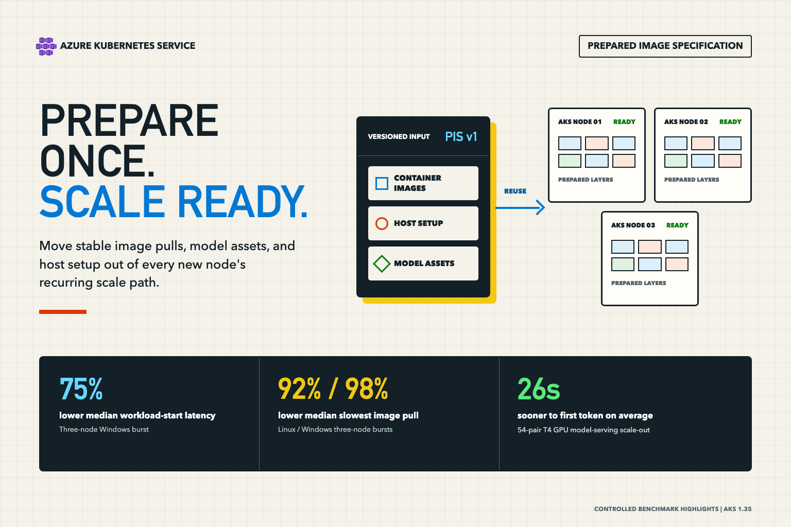

When an Azure Kubernetes Service (AKS) cluster needs more capacity, creating a virtual machine (VM) is only the beginning. Each new node still has to join the cluster, install host dependencies, pull container images, and start your workload before it can serve traffic.

While new nodes start, workloads wait. To compensate, teams keep spare nodes running, accept slower recovery when demand spikes, or maintain bootstrap scripts that every new node has to rerun.

Prepared Image Specification (PIS) lets you list the container images and host setup scripts that every new node needs, such as a large inference image, a language runtime, or an internal CA bundle. AKS bakes them into a versioned node image once, and new nodes in the pool boot from it instead of repeating that work.

<!-- truncate -->



**Bottom line:** PIS saves roughly the time each new node would otherwise spend pulling images and running setup. The more of that work your nodes do, the more PIS saves. In our tests, it cut a three-node Windows scale-out from 810 seconds to 202 seconds and returned the first token from a GPU model server 26 seconds sooner.

> **Preview notice:** PIS is currently an AKS preview feature. Preview features are opt-in, provided as-is and as-available, and not intended for production use. Review the current prerequisites, regions, limitations, and support policy before using it.

## What PIS does

**Bottom line:** You define what every new node needs once, and AKS prepares it ahead of time so scale-outs skip that work.

A PIS is a versioned Azure resource that lists container images to cache and Bash or PowerShell setup scripts to run. AKS builds a prepared node image from a supported AKS node image, and every new node in a PIS-backed pool boots from it. You don't build or maintain the image yourself.

PIS complements tools you might already use. An image pre-pull DaemonSet or [Artifact Streaming](https://learn.microsoft.com/azure/aks/artifact-streaming) still does its work after each node starts. PIS finishes the work before the node joins the pool, and it covers host setup as well as container images.

The tradeoff is a one-time build. Creating a PIS-backed pool took about 20 to 30 minutes in our tests, compared with about 4 minutes for a standard pool. You pay that cost when the pool is created or moves to a new PIS version, not on every scale-out.

## How much time PIS saves

**Bottom line:** Savings grow with the amount of download and setup work you move into the image. Windows pools, runtime installs, and large dependencies benefited most, and PIS made slow Windows scale-outs far less common.

Each comparison scaled a standard pool and a PIS-backed pool at the same time and measured from the scale request until the workload was running. Standard and PIS columns show typical (median) times unless noted, and time saved is the difference between them.

### Scaling out with cached container images

**Bottom line:** Windows scale-outs were up to 10 minutes faster, and the slowest Windows scale-outs dropped from about 14 minutes to about 4.

| Scenario | Standard | PIS | Typical time saved | Slowest 10% of scale-outs |
| --- | ---: | ---: | ---: | ---: |
| Add three Windows nodes | 810s | 202s | **About 10 minutes (75%)** | 849s vs. 246s (**71% faster**) |
| Add one Windows node | 246s | 190s | **56s (23%)** | 823s vs. 238s (**71% faster**) |
| Add three Linux nodes | 86s | 82s | **4s (4%)** | 104s vs. 98s (**6% faster**) |
| Add one Linux node | 81s | 80s | **2s (2%)** | 104s vs. 94s (**10% faster**) |

These workloads used a .NET application image of 90 MB on Linux and 171 MB on Windows. PIS removed almost all of the image pull time, about 10 seconds on Linux and 20 seconds on Windows.

The larger Windows gains came from more predictable node startup. Standard Windows nodes sometimes took more than 10 minutes to become ready, and none of the PIS-backed nodes did. A multi-node scale-out waits for its slowest node, so avoiding that delay is why the three-node Windows result is so large.

On Linux, a 90 MB image takes only a few seconds to pull, so the typical saving was small. In the slowest 10% of Linux scale-outs, PIS finished 6 to 10 seconds sooner. Larger images and setup tasks, shown below, produce larger Linux savings.

### Preparing runtimes and dependencies

**Bottom line:** Moving installs into the image saved up to 2 minutes per Windows node and up to 25 seconds per Linux node.

| Setup task | Standard | PIS | Typical time saved |
| --- | ---: | ---: | ---: |
| Install a Node.js runtime on Windows | 320s | 207s | **About 2 minutes (35%)** |
| Install a certificate and security policy on Windows | 254s | 198s | **56s (22%)** |
| Install a 512 MiB dependency bundle on Windows | 252s | 242s | **11s (4%)** |
| Install a 512 MiB dependency bundle on Linux | 135s | 110s | **25s (19%)** |
| Install a Node.js runtime on Linux | 123s | 107s | **16s (13%)** |

Windows installs take longer at node startup, so baking them into the image saved the most time. On Linux, the saving grew with the size of the download: the 512 MiB dependency bundle saved more time than the smaller runtime.

### Serving a model on a GPU node

**Bottom line:** For a T4 GPU model server, PIS returned the first token 26 seconds sooner on average by preloading a 2.6 GB inference image and a 2.4 GB model.

| Outcome (average) | Standard | PIS | Time saved |
| --- | ---: | ---: | ---: |
| Model ready to serve | 451s | 425s | **26s** |
| First token returned | 484s | 458s | **26s** |

With the inference image already on the node, the model server container started without waiting for a multi-gigabyte pull.

## When to use PIS

**Bottom line:** Use PIS for pools that scale out often and whose new nodes spend more than about half a minute pulling images or running setup.

Good fits include:

- **Large container images**, such as AI inference, data processing, or Windows application images.
- **Runtimes and dependency bundles** that every node installs, such as language runtimes, SDKs, or shared libraries.
- **Windows node pools**, where provisioning and image pulls tend to be slow.
- **Burst scaling**, where waiting for the slowest of several new nodes delays the whole scale-out.

PIS is a poor fit for small images, quick setup, content that changes more often than the pool scales, and pools that rarely scale. Kubernetes upgrades rebuild the prepared image automatically. To pick up new content or a newer AKS node image, create a new PIS version and point the pool at it.

## How to adopt PIS

**Bottom line:** You can move an existing pool's images and setup into a PIS in a few commands, then compare its scale-out time with your current pool.

1. **Pick what to prepare.** Start with the largest images and the setup steps every new node repeats.
2. **Create a PIS version.** List digest-pinned container images and any setup scripts.
3. **Create a PIS-backed node pool.** Reference the PIS version, scale it alongside your current pool, and compare how long workloads take to start.
4. **Roll out.** Point production pools at the tested version, and create a new version when your images or scripts change.

Register the preview and install the `aks-preview` extension:

```bash
az feature register --namespace Microsoft.ContainerService --name AKSPreparedImageSpecificationPreview
az provider register --namespace Microsoft.ContainerService
az extension add --name aks-preview --upgrade
```

Create a PIS version that caches your image, then add a node pool that uses it:

```bash
RESOURCE_GROUP="my-resource-group"
CLUSTER_NAME="my-aks-cluster"
PIS_NAME="my-pis"

az aks prepared-image-specification create \
  --resource-group "$RESOURCE_GROUP" \
  --name "$PIS_NAME" \
  --version v1 \
  --location "$(az aks show --resource-group "$RESOURCE_GROUP" --name "$CLUSTER_NAME" --query location --output tsv)" \
  --container-images "myacr.azurecr.io/my-app@sha256:<digest>"

PIS_VERSION_ID=$(az aks prepared-image-specification version show \
  --resource-group "$RESOURCE_GROUP" \
  --pis-name "$PIS_NAME" \
  --name v1 \
  --query id \
  --output tsv)

az aks nodepool add \
  --resource-group "$RESOURCE_GROUP" \
  --cluster-name "$CLUSTER_NAME" \
  --name pispool \
  --prepared-image-specification-id "$PIS_VERSION_ID"
```

To also bake in runtimes, dependencies, or certificates, add setup scripts with `--customization-scripts`. The [PIS how-to guide](https://learn.microsoft.com/azure/aks/prepared-image-specification) covers scripts, registry access, and permissions.

## Conclusion

**Bottom line:** PIS turns repeated per-node setup into a one-time build, so pools with large images or heavy setup scale out faster and more predictably.

The benefit is largest for Windows pools, large images, and runtime or dependency installs, and smallest when nodes have little to download. Because PIS is in preview, try it in a nonproduction pool first and follow the [AKS roadmap](https://github.com/orgs/Azure/projects/685) as the feature evolves.

## Resources

- [Prepared Image Specification overview](https://learn.microsoft.com/azure/aks/prepared-image-specification-overview)
- [Create and manage a Prepared Image Specification](https://learn.microsoft.com/azure/aks/prepared-image-specification)
- [Reduce image pull time with Artifact Streaming](https://learn.microsoft.com/azure/aks/artifact-streaming)
- [AKS preview feature support policy](https://learn.microsoft.com/azure/aks/support-policies)
- [AKS roadmap](https://github.com/orgs/Azure/projects/685)
