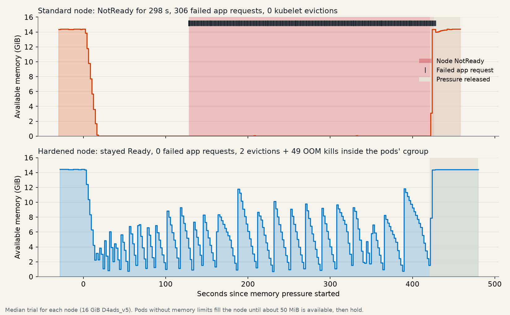

When a pod on an Azure Kubernetes Service (AKS) node leaks memory or saturates CPU, the damage rarely stays inside that pod. The kubelet, the container runtime, and host services share the same node. If they're starved, a node can stop starting pods, the kernel can terminate processes abruptly, and in the worst case the node can stop reporting healthy.

Node Hardening is an AKS preview feature that changes how Linux nodes reserve and protect resources. It enforces kube-reserved and system-reserved capacity with Linux control groups (cgroups), raises the hard memory eviction threshold, and adds soft eviction so the kubelet can remove pods gracefully before a node runs out of memory.

We ran controlled benchmarks on otherwise identical standard and hardened nodes to measure what changes in practice. When pods held a node's memory near capacity, the standard node went NotReady in all five trials, while the hardened node stayed Ready and evicted or contained the pods. Node Hardening also protected nodes from a runaway memory leak, and it cost between 4% and 15% of allocatable memory. We also noted that pod operations slowed down on nodes whose CPU was fully saturated.

<!-- truncate -->


> **Preview notice:** Node Hardening is currently an AKS preview feature. Preview features are opt-in, provided as-is and as-available, and not intended for production use. Default values might change before general availability.

## Results at a glance

| Scenario | Standard node | Hardened node | What it means |
| --- | ---: | ---: | --- |
| Trials where the node went NotReady while pods held memory near capacity | 5 of 5 | 0 of 5 | The hardened node evicted or contained the pods before the kubelet was starved. |
| Failed requests to an app on that node during those trials | 33% | 0% | Workloads that stayed within their own limits kept serving traffic. |
| Lowest available memory during a runaway memory leak | 11 MiB | 776 MiB | The hardened node kept headroom for the kubelet and host services. |
| How runaway pods were stopped | 5 kernel OOM kills | 3 kubelet evictions, 2 pod-cgroup OOM kills | The kubelet, rather than the kernel's last-resort OOM killer, did most of the work. |
| Time the kubelet and containerd stalled on memory | up to 7.1% | 0% | Node agents kept running at full speed during memory pressure. |
| Allocatable memory per node | baseline | 4% to 15% less | Plan for slightly less schedulable capacity. |
| New pod start on a node with fully saturated CPU | 2.9 s | 33.4 s | Something to note if your nodes regularly saturate CPU. |

Values are medians across repeated trials.

## What Node Hardening changes

Node Hardening is a cluster-level setting for Linux node pools. When it's enabled, AKS makes the following changes on each node:

- **Enforced reservations:** The kubelet and containerd run in a dedicated `kubereserved.slice` cgroup, and host services run in `system.slice`. Each cgroup's memory is limited to its reserved value, and the `kubepods.slice` cgroup that contains every pod is limited to the remaining node memory. CPU reservations become proportional CPU weights rather than hard limits, as described in [CPU saturation: something to note](#cpu-saturation-something-to-note).
- **System-reserved capacity:** Host operating system services get their own CPU, memory, and ephemeral storage reservation.
- **Larger kube-reserved memory:** Kube-reserved memory scales with the maximum number of pods per node, which accounts for the kubelet and containerd overhead of running more pods.
- **Earlier, more graceful eviction:** The hard eviction threshold for available memory scales with node size, and new soft eviction thresholds give pods a grace period to shut down before the node reaches the hard threshold.

For the full list of default values and the settings that you can customize, see [Node Hardening (preview) in AKS](https://learn.microsoft.com/azure/aks/node-hardening).

## How we tested

We compared two otherwise identical AKS 1.35 clusters, one with Node Hardening enabled, on a 4-vCPU, 16 GiB test node. In each five- to seven-minute trial, pods without resource limits held the node's memory near capacity, leaked memory past the node's capacity, or saturated its CPU. We ran five trials of each scenario on each cluster and measured node health, a well-behaved app on the same node, and how quickly new pods started. We also measured allocatable capacity on node sizes from 8 GiB to 64 GiB.

## What hardening reserves on each node

Node Hardening increases kube-reserved memory, adds system-reserved memory, and raises the hard eviction threshold. The scheduler subtracts all three from node capacity, so every node reports less allocatable memory.


| Node memory | Max pods | Kube-reserved memory, standard / hardened | System-reserved memory | Hard eviction, standard / hardened | Allocatable memory, standard / hardened | Change |
| --- | ---: | ---: | ---: | ---: | ---: | ---: |
| 8 GiB (D2ads_v5) | 30 | 650 MiB / 1,300 MiB | 300 MiB | 100 MiB / 250 MiB | 7.0 / 5.9 GiB | -15.3% |
| 16 GiB (D4ads_v5) | 30 | 650 MiB / 1,377 MiB | 300 MiB | 100 MiB / 375 MiB | 14.9 / 13.6 GiB | -8.5% |
| 32 GiB (D8ads_v5) | 30 | 650 MiB / 1,705 MiB | 400 MiB | 100 MiB / 512 MiB | 30.6 / 28.8 GiB | -6.0% |
| 64 GiB (D16ads_v5) | 30 | 650 MiB / 2,360 MiB | 500 MiB | 100 MiB / 512 MiB | 62.1 / 59.5 GiB | -4.1% |
| 16 GiB (D4ads_v5) | 250 | 4,096 MiB / 4,096 MiB | 300 MiB | 100 MiB / 375 MiB | 11.5 / 11.0 GiB | -4.9% |
| 32 GiB (D8ads_v5) | 250 | 5,050 MiB / 8,192 MiB | 400 MiB | 100 MiB / 512 MiB | 26.3 / 22.4 GiB | -14.7% |

Every hardened node also reported 100 millicores less allocatable CPU and 1 GiB less allocatable ephemeral storage.

The largest relative reductions were on the smallest node and on the high-density node. On small nodes, the fixed parts of the reservation are a larger share of memory. On a 32 GiB node with 250 pods, the higher per-pod kube-reserved memory reaches the 25% cap. On a 16 GiB node with 250 pods, both configurations already reach the 25% cap, so the difference is only the system reservation and eviction threshold.

**What this means for you:** Before you enable Node Hardening, check how close your nodes run to their allocatable memory. Workloads that fit on a node today might need a few percent more nodes afterward.

## Memory held near capacity: standard nodes went NotReady

Memory pressure often takes a node down not with a sudden spike, but with workloads that use far more memory than they request and keep the node at the edge of its memory. To reproduce that, pods without memory limits grew until the node had about 50 MiB of memory available and then held there for seven minutes, while another pod read files from disk as a typical app does.



| Memory held near capacity, five trials per node | Standard | Hardened |
| --- | ---: | ---: |
| Trials where the node went NotReady | 5 of 5 | 0 of 5 |
| Time until the node went NotReady (median) | 128 s | – |
| Time the node was NotReady (median) | 298 s | 0 s |
| Longest gap between kubelet lease renewals (median) | 372 s | 10 s |
| Failed requests to the well-behaved app (median) | 33% | 0% |
| Kubelet evictions (median) | 0 | 5 |
| Kernel OOM kills (median) | 0 | 48, inside the pods' cgroup |
| Lowest available node memory (median) | 15 MiB | 729 MiB |
| Peak time the node was stalled on memory (10-second PSI, median) | 69% | 6.7% |

On the standard node, nothing stepped in to stop the pods. The kubelet didn't evict any pods, and the kernel OOM killer didn't act in four of the five trials, because the kernel could keep reclaiming page cache to make room. Instead, the node thrashed, and at its worst it spent about 70% of its time stalled on memory. The kubelet stopped renewing its lease, the node went NotReady, and the well-behaved app on the node failed about a third of its requests until the pods released their memory.

On the hardened node, the `kubepods.slice` limit stopped the pods while the node still had about 700 MiB of memory available. The kernel killed the growing processes inside the pods' cgroup, and the kubelet evicted pods as memory crossed its eviction thresholds. The node stayed Ready in every trial, and the app on the node didn't fail a single request. Only the test workloads were evicted.

## Runaway memory: hardening kept the node healthy

The following chart shows the median trial for each node.


On the standard node, the leaking pods consumed almost all node memory before anything stopped them. The kubelet's default hard eviction threshold of 100 MiB was too small to act in time, so the kernel's out-of-memory (OOM) killer stopped the pods instead. Available memory repeatedly dropped close to zero, and the kernel reclaimed host page cache, including memory used by the kubelet and containerd, to keep going.

On the hardened node, two mechanisms acted earlier:

- The `kubepods.slice` cgroup limit kept pods from taking memory reserved for the kubelet, containerd, and host services. When pods reached that limit, the kernel reclaimed and killed processes only inside the pods' cgroup.
- Soft and hard eviction thresholds let the kubelet evict the leaking pods while the node still had headroom.

| Runaway memory, median of trials | Standard | Hardened |
| --- | ---: | ---: |
| Lowest available node memory | 11 MiB | 776 MiB |
| Kubelet evictions | 0 | 3 |
| Kernel OOM kills | 5 (system-wide) | 2 (inside the pods' cgroup) |
| Peak time the kubelet and containerd were stalled on memory (10-second PSI) | 3.2% | 0% |
| Peak time the node was stalled on memory (10-second PSI) | 6.7% | 2.8% |
| Well-behaved app, 99th percentile latency | 14.3 ms | 8.3 ms |
| Well-behaved app, failed requests in the worst trial | 0.07% | 0% |
| New pod start time | 1.8 s | 1.8 s |

In every runaway-leak trial, the Guaranteed app kept running on both nodes, and the kubelet only evicted the leaking pods. Because the leak grew quickly, the standard node's kernel OOM killer stopped it before the node thrashed long enough to go NotReady. The hardened node reported the `MemoryPressure` condition for several minutes after each trial, which includes the kubelet's default five-minute pressure transition period. While that condition is set, the node has the `node.kubernetes.io/memory-pressure` taint, which can keep new pods from being scheduled on it.

## CPU saturation: something to note

In AKS, memory saturation is a more common cause of node instability than CPU saturation. The CPU results are worth knowing about if your nodes regularly run at full CPU, for example, with CPU-intensive pods that don't have CPU limits.


| CPU saturation, median of trials | Standard | Hardened |
| --- | ---: | ---: |
| New pod start time | 2.9 s | 33.4 s |
| Six-replica rollout time | 6.0 s | 69.4 s |
| Time the kubelet and containerd were stalled waiting for CPU (median 10-second PSI) | 8% | 69% |
| Well-behaved app, 99th percentile latency | 12.1 ms | 10.6 ms |
| Node NotReady time | 0 s | 0 s |

When pods saturate a node's CPU, Linux shares CPU time between cgroups in proportion to their CPU weights, which the kubelet derives from the reservations. On a standard node, the kubelet and containerd run in `system.slice` with the default weight of 100. On a hardened 4-vCPU node, they run in `kubereserved.slice`, whose weight of 6 comes from the default kube-reserved CPU of 140 millicores. That share is enough for steady-state work, but it leaves less room for bursts of pod starts and container operations while CPU is fully saturated.

The well-behaved app, which had its own CPU request, wasn't affected, and no node became NotReady. Only node operations such as starting pods and rolling out deployments slowed down, and they returned to normal within seconds after CPU contention ended. Kube-reserved CPU is one of the [Node Hardening settings that you can customize](https://learn.microsoft.com/azure/aks/node-hardening#customize-node-hardening-settings). In a separate test, a value of 500 millicores brought the median pod start time to 4.2 seconds.

## Other observations

- **The system reservation is a hard limit:** Host services in `system.slice` share a memory limit equal to the system-reserved memory, 300 MiB on our test node. In one of our early validation runs, a firmware update service (`fwupd`) started on a timer and was OOM-killed when it reached that limit. If you run your own agents on nodes as systemd services, such as security or log-forwarding agents, validate their memory use before you rely on Node Hardening.
- **Process ID reservations are removed:** Hardened nodes don't set the kube-reserved process ID reservation or the `pid.available` hard eviction threshold that standard nodes use.
- **Hardened nodes never went NotReady:** Across every scenario, hardened nodes renewed their lease at the normal interval. Standard nodes went NotReady only when memory was held near capacity.

## Recommendations

- **Consider Node Hardening if** your nodes run workloads that can exceed their memory requests, such as caches, JVM applications, or batch jobs, and you've seen nodes go NotReady, kernel OOM kills, evictions of the wrong pods, or unresponsive nodes.
- **Plan capacity first:** Expect 4% to 15% less allocatable memory, 100 millicores less allocatable CPU, and 1 GiB less ephemeral storage per node.
- **Keep CPU saturation in mind:** If your nodes regularly run at full CPU, check pod start and rollout times after you enable Node Hardening.
- **Validate host agents:** Check the memory use of any systemd services that you add to nodes against the system-reserved memory.
- **Test with your own workloads:** Start with a nonproduction cluster, and reproduce the burst patterns that have caused node pressure in the past.

## Try Node Hardening

Install the `aks-preview` extension and register the `CustomNodeConfigPreview` feature flag:

```azurecli
az extension add --name aks-preview
az extension update --name aks-preview
az feature register --namespace Microsoft.ContainerService --name CustomNodeConfigPreview
```

Registration is asynchronous and can take a few minutes. Re-run the following command until it reports `Registered`:

```azurecli
az feature show \
    --namespace Microsoft.ContainerService \
    --name CustomNodeConfigPreview \
    --query properties.state -o tsv
```

Once it prints `Registered`, refresh the resource provider and enable Node Hardening on a cluster:

```azurecli
az provider register --namespace Microsoft.ContainerService

az aks update \
    --resource-group <resource-group-name> \
    --name <cluster-name> \
    --enable-node-hardening
```

Node Hardening applies to all Linux node pools in the cluster. If you disable it later, existing node pools keep the hardened soft eviction settings, so you need to create new node pools to remove them. For details, see [Node Hardening (preview) in AKS](https://learn.microsoft.com/azure/aks/node-hardening).

## Limitations

- **Synthetic workloads:** The stressors were designed to create sustained memory and CPU pressure. Real workloads grow and burst differently. For example, a leak that grows quickly can trigger the kernel OOM killer before a standard node goes NotReady, as in the runaway-leak scenario.
- **One test VM size:** Stress trials ran on one 4-vCPU, 16 GiB node. CPU weights, reservations, and eviction thresholds differ on other node sizes.
- **Small number of trials:** We ran five trials per scenario on each node. The results were consistent across trials, but they don't capture every condition.
- **Preview defaults:** Node Hardening is in preview, and default values might change before general availability.

## Learn more

- [Node Hardening (preview) in AKS](https://learn.microsoft.com/azure/aks/node-hardening)
- [Custom node configuration parameters for AKS](https://learn.microsoft.com/azure/aks/custom-node-configuration-reference)
- [Node resource reservations in AKS](https://learn.microsoft.com/azure/aks/node-resource-reservations)
- [Node-pressure eviction in Kubernetes](https://kubernetes.io/docs/concepts/scheduling-eviction/node-pressure-eviction/)
- [Reserve compute resources for system daemons in Kubernetes](https://kubernetes.io/docs/tasks/administer-cluster/reserve-compute-resources/)
