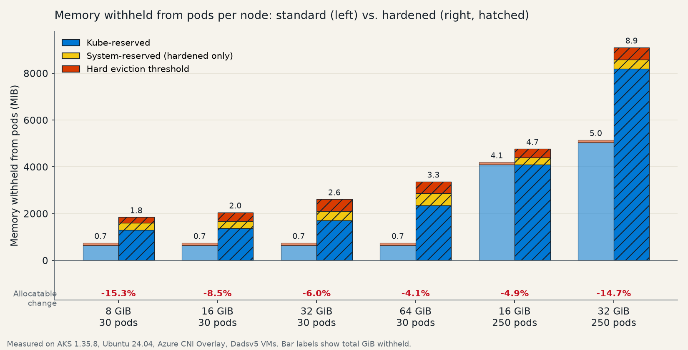
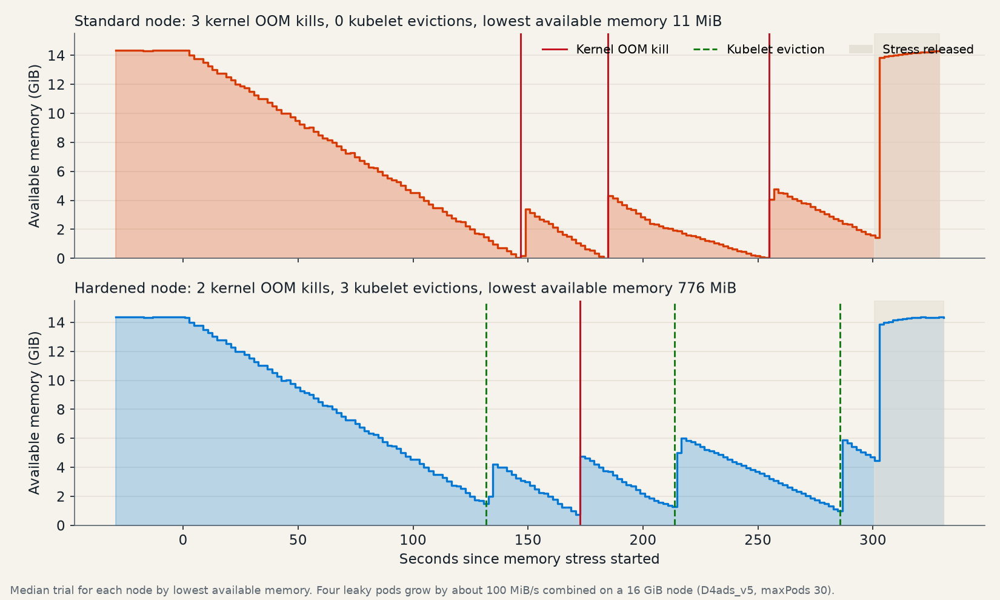
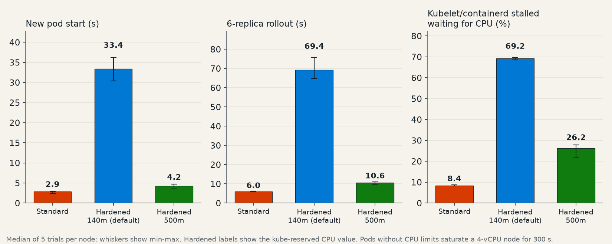

When a pod on an Azure Kubernetes Service (AKS) node leaks memory or saturates CPU, the damage rarely stays inside that pod. The kubelet, the container runtime, and host services share the same node. If they're starved, a node can stop starting pods, the kernel can terminate processes abruptly, and in the worst case the node can stop reporting healthy.

Node Hardening is an AKS preview feature that changes how Linux nodes reserve and protect resources. It enforces kube-reserved and system-reserved capacity with Linux control groups (cgroups), raises the hard memory eviction threshold, and adds soft eviction so the kubelet can remove pods gracefully before a node runs out of memory.

We ran controlled benchmarks on otherwise identical standard and hardened nodes to measure what changes in practice. Node Hardening clearly protected nodes from runaway memory, cost between 4% and 15% of allocatable memory, and slowed pod operations on CPU-saturated nodes until we raised the kube-reserved CPU value.

<!-- truncate -->


> **Preview notice:** Node Hardening is currently an AKS preview feature. Preview features are opt-in, provided as-is and as-available, and not intended for production use. Default values might change before general availability.

## Results at a glance

| Scenario | Standard node | Hardened node | What it means |
| --- | ---: | ---: | --- |
| Lowest available memory during a runaway memory leak | 11 MiB | 776 MiB | The hardened node kept headroom for the kubelet and host services. |
| How runaway pods were stopped | 5 kernel OOM kills | 3 kubelet evictions, 2 pod-cgroup OOM kills | The kubelet, rather than the kernel's last-resort OOM killer, did most of the work. |
| Time the kubelet and containerd stalled on memory | up to 7.1% | 0% | Node agents kept running at full speed during memory pressure. |
| Allocatable memory per node | baseline | 4% to 15% less | Plan for slightly less schedulable capacity. |
| New pod start while pods saturate CPU | 2.9 s | 33.4 s | With default settings, the kubelet gets a small CPU share under contention. |
| New pod start while pods saturate CPU, kube-reserved CPU at 500m | 2.9 s | 4.2 s | Raising kube-reserved CPU recovered most of the difference. |

Values are medians across repeated trials. The sections below describe the methodology, the full results, and the limitations.

## What Node Hardening changes

Node Hardening is a cluster-level setting for Linux node pools. When it's enabled, AKS makes the following changes on each node:

- **Enforced reservations:** The kubelet and containerd run in a dedicated `kubereserved.slice` cgroup, and host services run in `system.slice`. Both cgroups are limited to their reserved values, and the `kubepods.slice` cgroup that contains every pod is limited to the remaining node memory.
- **System-reserved capacity:** Host operating system services get their own CPU, memory, and ephemeral storage reservation.
- **Larger kube-reserved memory:** Kube-reserved memory scales with the maximum number of pods per node, which accounts for the kubelet and containerd overhead of running more pods.
- **Earlier, more graceful eviction:** The hard eviction threshold for available memory scales with node size, and new soft eviction thresholds give pods a grace period to shut down before the node reaches the hard threshold.

For the full list of default values and the settings that you can customize, see [Node Hardening (preview) in AKS](https://learn.microsoft.com/azure/aks/node-hardening).

## How we tested

We created two AKS clusters that differed only in the `--enable-node-hardening` setting, and later a third hardened cluster to test a tuning change.

| Setting | Value |
| --- | --- |
| Kubernetes version | 1.35.8 |
| Node image | AKSUbuntu-2404gen2containerd-202609.15.0 |
| Networking | Azure CNI Overlay |
| Test node | One `Standard_D4ads_v5` node (4 vCPUs, 16 GiB), `maxPods` 30, tainted so that only test pods ran on it |
| Allocation measurements | Additional node pools from 8 GiB to 64 GiB, with `maxPods` 30 and 250 |
| Region | East US 2 |

Each trial ran one of two scenarios on the test node for 300 seconds, after a 60-second baseline:

- **Runaway memory:** Four pods without memory limits each grew by 64 MiB every 2.5 seconds, up to 5 GiB each. The combined demand of about 20 GiB exceeded the node's memory, so the node had to stop them.
- **CPU saturation:** Four pods without CPU limits each ran four busy processes, and a six-replica deployment was restarted every 30 seconds to exercise the kubelet and containerd.

During every trial, we measured the following:

- A well-behaved Guaranteed quality-of-service web app on the test node, called five times per second from another node.
- How long a new pod on the test node took to become Ready, sampled every 20 seconds.
- Node conditions, lease renewals, kubelet health checks, kubelet evictions, and node events.
- On the node itself: available memory, cgroup memory and CPU pressure (pressure stall information, or PSI), cgroup OOM kills, and kubelet and containerd CPU use.

We ran five trials of each scenario on the standard and hardened nodes, and five CPU-saturation trials on the tuned hardened node. Stressor pods were removed and the node was confirmed healthy before each trial started.

## What hardening reserves on each node

Node Hardening increases kube-reserved memory, adds system-reserved memory, and raises the hard eviction threshold. The scheduler subtracts all three from node capacity, so every node reports less allocatable memory.



| Node memory | Max pods | Kube-reserved memory, standard / hardened | System-reserved memory | Hard eviction, standard / hardened | Allocatable memory, standard / hardened | Change |
| --- | ---: | ---: | ---: | ---: | ---: | ---: |
| 8 GiB (D2ads_v5) | 30 | 650 MiB / 1,300 MiB | 300 MiB | 100 MiB / 250 MiB | 7.0 / 5.9 GiB | -15.3% |
| 16 GiB (D4ads_v5) | 30 | 650 MiB / 1,377 MiB | 300 MiB | 100 MiB / 375 MiB | 14.9 / 13.6 GiB | -8.5% |
| 32 GiB (D8ads_v5) | 30 | 650 MiB / 1,705 MiB | 400 MiB | 100 MiB / 512 MiB | 30.6 / 28.8 GiB | -6.0% |
| 64 GiB (D16ads_v5) | 30 | 650 MiB / 2,360 MiB | 500 MiB | 100 MiB / 512 MiB | 62.1 / 59.5 GiB | -4.1% |
| 16 GiB (D4ads_v5) | 250 | 4,096 MiB / 4,096 MiB | 300 MiB | 100 MiB / 375 MiB | 11.5 / 11.0 GiB | -4.9% |
| 32 GiB (D8ads_v5) | 250 | 5,050 MiB / 8,192 MiB | 400 MiB | 100 MiB / 512 MiB | 26.3 / 22.4 GiB | -14.7% |

Every hardened node also reported 100 millicores less allocatable CPU and 1 GiB less allocatable ephemeral storage.

The largest relative reductions were on the smallest node and on the high-density node. On small nodes, the fixed parts of the reservation are a larger share of memory. On a 32 GiB node with 250 pods, the higher per-pod kube-reserved memory reaches the 25% cap. On a 16 GiB node with 250 pods, both configurations already reach the 25% cap, so the difference is only the system reservation and eviction threshold.

**What this means for you:** Before you enable Node Hardening, check how close your nodes run to their allocatable memory. Workloads that fit on a node today might need a few percent more nodes afterward.

## Runaway memory: hardening kept the node healthy

The following chart shows the median trial for each node.



On the standard node, the leaking pods consumed almost all node memory before anything stopped them. The kubelet's default hard eviction threshold of 100 MiB was too small to act in time, so the kernel's out-of-memory (OOM) killer stopped the pods instead. Available memory repeatedly dropped close to zero, and the kernel reclaimed host page cache, including memory used by the kubelet and containerd, to keep going.

On the hardened node, two mechanisms acted earlier:

- The `kubepods.slice` cgroup limit kept pods from taking memory reserved for the kubelet, containerd, and host services. When pods reached that limit, the kernel reclaimed and killed processes only inside the pods' cgroup.
- Soft and hard eviction thresholds let the kubelet evict the leaking pods while the node still had headroom.

| Runaway memory, median of trials | Standard | Hardened |
| --- | ---: | ---: |
| Lowest available node memory | 11 MiB | 776 MiB |
| Kubelet evictions | 0 | 3 |
| Kernel OOM kills | 5 (system-wide) | 2 (inside the pods' cgroup) |
| Peak time the kubelet and containerd were stalled on memory (10-second PSI) | 3.2% | 0% |
| Peak time the node was stalled on memory (10-second PSI) | 6.7% | 2.8% |
| Well-behaved app, 99th percentile latency | 14.3 ms | 8.3 ms |
| Well-behaved app, failed requests in the worst trial | 0.07% | 0% |
| New pod start time | 1.8 s | 1.8 s |

In every trial, the Guaranteed app kept running on both nodes, and the kubelet only evicted the leaking pods. Neither node became NotReady. The hardened node reported the `MemoryPressure` condition for several minutes after each trial, which includes the kubelet's default five-minute pressure transition period. While that condition is set, the node has the `node.kubernetes.io/memory-pressure` taint, which can keep new pods from being scheduled on it.

## CPU saturation: tune kube-reserved CPU

The CPU results showed a tradeoff that's important to understand before you enable Node Hardening on nodes that run CPU-intensive pods without CPU limits.



| CPU saturation, median of trials | Standard | Hardened (default) | Hardened, kube-reserved CPU 500m |
| --- | ---: | ---: | ---: |
| New pod start time | 2.9 s | 33.4 s | 4.2 s |
| Six-replica rollout time | 6.0 s | 69.4 s | 10.6 s |
| Time the kubelet and containerd were stalled waiting for CPU (median 10-second PSI) | 8% | 69% | 26% |
| Well-behaved app, 99th percentile latency | 12.1 ms | 10.6 ms | 9.8 ms |
| Node NotReady time | 0 s | 0 s | 0 s |

The difference comes from how Linux divides CPU time between cgroups under contention. With cgroup v2, the kubelet converts each reservation into a CPU weight, and the kernel shares CPU in proportion to those weights.

| Cgroup that contains the kubelet and containerd | Standard | Hardened (default 140m) | Hardened (500m) |
| --- | ---: | ---: | ---: |
| Cgroup | `system.slice` | `kubereserved.slice` | `kubereserved.slice` |
| CPU weight | 100 | 6 | 20 |
| CPU weight of `kubepods.slice` | 151 | 147 | 133 |
| Approximate CPU share for that cgroup when pods saturate CPU | about 40% | about 4% | about 13% |

On a standard node, the kubelet and containerd run in `system.slice` with the default weight of 100, so that cgroup gets a large share of CPU when pods saturate it. On a hardened node, their weight comes from the kube-reserved CPU value. The default of 140 millicores on a 4-vCPU node translates to a weight of 6, which is enough for steady-state work but not for bursts of pod starts and container operations.

The well-behaved app, which had its own CPU request, wasn't affected on any node, and no node became NotReady. The slowdown affected node operations such as starting pods and rolling out deployments.

Raising kube-reserved CPU to 500 millicores with a custom kubelet configuration reduced the median pod start time from 33.4 seconds to 4.2 seconds, compared with 2.9 seconds on the standard node. It also cut the median rollout time from 69.4 seconds to 10.6 seconds. The tradeoff is 360 millicores less allocatable CPU per node.

```json
{
  "kubeReserved": {
    "cpuMillicores": 500
  }
}
```

```azurecli
az aks nodepool add \
    --resource-group <resource-group-name> \
    --cluster-name <cluster-name> \
    --name <node-pool-name> \
    --kubelet-config ./kubelet-config.json
```

Values that you don't set keep the Node Hardening defaults. Setting CPU limits on your workloads also reduces this risk, because pods with CPU limits can't saturate the node's CPU.

## Other observations

- **The system reservation is a hard limit:** Host services in `system.slice` share a memory limit equal to the system-reserved memory, 300 MiB on our test node. In one of our early validation runs, a firmware update service (`fwupd`) started on a timer and was OOM-killed when it reached that limit. If you run your own agents on nodes as systemd services, such as security or log-forwarding agents, validate their memory use before you rely on Node Hardening.
- **Process ID reservations are removed:** Hardened nodes don't set the kube-reserved process ID reservation or the `pid.available` hard eviction threshold that standard nodes use.
- **No node became NotReady in any trial:** Lease renewals stayed at their normal interval on every node, so the differences in this post are about how well the node kept doing its work, not whether it stayed connected.

## Recommendations

- **Consider Node Hardening if** your nodes run workloads that can exceed their memory requests, such as caches, JVM applications, or batch jobs, and you've seen kernel OOM kills, evictions of the wrong pods, or unresponsive nodes.
- **Plan capacity first:** Expect 4% to 15% less allocatable memory, 100 millicores less allocatable CPU, and 1 GiB less ephemeral storage per node.
- **Tune kube-reserved CPU for CPU-heavy nodes:** If pods regularly saturate node CPU, test a higher `kubeReserved.cpuMillicores` value, such as 500 millicores on a 4-vCPU node.
- **Validate host agents:** Check the memory use of any systemd services that you add to nodes against the system-reserved memory.
- **Test with your own workloads:** Start with a nonproduction cluster, and reproduce the burst patterns that have caused node pressure in the past.

## Try Node Hardening

Install the `aks-preview` extension, register the `CustomNodeConfigPreview` feature flag, and enable Node Hardening on a cluster:

```azurecli
az extension add --name aks-preview
az extension update --name aks-preview
az feature register --namespace Microsoft.ContainerService --name CustomNodeConfigPreview
az provider register --namespace Microsoft.ContainerService

az aks update \
    --resource-group <resource-group-name> \
    --name <cluster-name> \
    --enable-node-hardening
```

Node Hardening applies to all Linux node pools in the cluster. If you disable it later, existing node pools keep the hardened soft eviction settings, so you need to create new node pools to remove them. For details, see [Node Hardening (preview) in AKS](https://learn.microsoft.com/azure/aks/node-hardening).

## Limitations

- **Synthetic workloads:** The stressors were designed to create sustained memory and CPU pressure. Real workloads grow and burst differently.
- **One test VM size:** Stress trials ran on one 4-vCPU, 16 GiB node. CPU weights, reservations, and eviction thresholds differ on other node sizes.
- **Small number of trials:** We ran five trials per scenario on each node. The results were consistent across trials, but they don't capture every condition.
- **Preview defaults:** Node Hardening is in preview, and default values might change before general availability.

## Learn more

- [Node Hardening (preview) in AKS](https://learn.microsoft.com/azure/aks/node-hardening)
- [Custom node configuration parameters for AKS](https://learn.microsoft.com/azure/aks/custom-node-configuration-reference)
- [Node resource reservations in AKS](https://learn.microsoft.com/azure/aks/node-resource-reservations)
- [Node-pressure eviction in Kubernetes](https://kubernetes.io/docs/concepts/scheduling-eviction/node-pressure-eviction/)
- [Reserve compute resources for system daemons in Kubernetes](https://kubernetes.io/docs/tasks/administer-cluster/reserve-compute-resources/)
