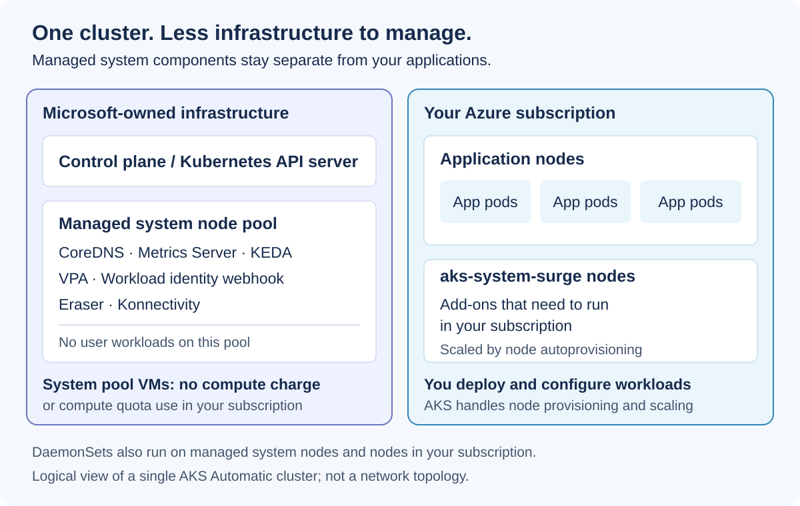

Azure Kubernetes Service (AKS) Automatic now gives you a path to leverage managed system node pools, expanded service level agreement (SLA) coverage, and native Terraform support. You also get more control over workload guardrails and new traffic-management options.

This roundup explains what's changed and what you need to configure. If you still use managed NGINX ingress, prioritize migration before Microsoft's critical security patch support ends in November 2026.

<!-- truncate -->

## Migrate an existing Automatic cluster to managed system node pools (preview)

In AKS, nodes with the same configuration are grouped into *node pools*. *System node pools* host the platform components that keep your cluster healthy, while *user node pools* run your application workloads. With managed system node pools, AKS runs the system pool on Microsoft-owned infrastructure, so you stop managing that layer entirely.

- **Managed system node pools on AKS Automatic.** The system pool is fully managed, including provisioning, patching, upgrades, scaling, and node auto-repair.
- **Every new Automatic cluster uses managed system node pools by default.** You can't create an Automatic cluster without them, and the capability is available in every region where AKS Automatic runs.
- **System node pool VMs aren't billed to your subscription.** Core platform components run on Microsoft-owned infrastructure, so they don't consume your compute quota.

Managed system node pools have been generally available since June and are the default for new Automatic clusters. What's new is a way for [existing Automatic clusters to adopt them without recreating the cluster](https://learn.microsoft.com/azure/aks/automatic/aks-automatic-managed-system-node-pools-about#migrate-an-existing-aks-automatic-cluster-to-managed-system-node-pools-preview). Existing clusters aren't changed automatically.

:::caution

Migration is in preview and is one-way: you can't revert to non-managed system node pools. 

:::

### Why consider migration?

- **Less operational overhead.** AKS provisions, patches, upgrades, and scales the system pool for you. There's no system pool capacity to plan and no system nodes to maintain.
- **Less capacity planning.** You no longer size the managed system pool or allocate compute quota for its VMs.
- **Avoid dedicated system VM charges.** If your cluster has three dedicated system nodes, migration can remove those VM compute charges from your subscription. Removing that fixed overhead matters especially for small clusters.
- **Stronger isolation.** Platform components are isolated from your application workloads and backed by an SLA.

## Managed system components SLA

AKS Automatic now includes a financially backed **99.9% uptime commitment for managed system components on clusters with availability zones enabled**. Published in the August 2026 Microsoft Online Services SLA, this commitment extends coverage beyond the Kubernetes API server to platform services on the managed system node pool.

For this commitment, downtime counts when at least one managed system component has no system pod running. It isn't an application availability or request latency guarantee.

| Managed system components uptime | Service credit |
| --- | --- |
| Below 99.9% | 10% |
| Below 99% | 25% |
| Below 95% | 100% |

Together with the API server uptime SLA and the pod readiness SLA for qualifying workloads, this adds a guarantee for another layer of your cluster. Review the [published SLA](https://www.microsoft.com/licensing/docs/view/Service-Level-Agreements-SLA-for-Online-Services) for eligibility, calculations, exclusions, and credit claim requirements.

### Which components does AKS manage?

For context, managed system node pools isolate core platform components on Microsoft-owned infrastructure. AKS handles provisioning, patching, upgrades, scaling, and node auto-repair. System pool VMs don't incur compute charges or consume compute quota in your subscription.

| Component | Description |
| --- | --- |
| [Workload identity webhook](https://learn.microsoft.com/azure/aks/workload-identity-overview) | Injects projected tokens and environment variables for Microsoft Entra ID authentication |
| [CoreDNS](https://learn.microsoft.com/azure/aks/coredns-custom) | Provides cluster DNS resolution for service discovery |
| [Eraser](https://learn.microsoft.com/azure/aks/image-cleaner) | Removes unused and vulnerable container images from nodes |
| [Kubernetes Event-driven Autoscaling (KEDA)](https://learn.microsoft.com/azure/aks/keda-about) | Scales workloads based on event-driven metrics |
| Konnectivity | Maintains secure connectivity between the control plane and nodes |
| [Metrics Server](https://learn.microsoft.com/azure/aks/monitor-aks-reference) | Exposes resource metrics for the Horizontal Pod Autoscaler and `kubectl top` |
| [Vertical Pod Autoscaler (VPA)](https://learn.microsoft.com/azure/aks/vertical-pod-autoscaler) | Recommends and applies optimal CPU and memory requests for pods |

Other add-ons and extensions run on `aks-system-surge` nodes, with scaling handled by [node autoprovisioning](https://learn.microsoft.com/azure/aks/node-autoprovision). DaemonSets run on both the managed system node pool and nodes in your subscription. See the [managed system node pools documentation](https://aka.ms/aks/ManagedSystemNodePools) for details.

## Terraform support for AKS Automatic

For your next cluster, bring Automatic into your infrastructure-as-code workflow. Terraform now has a dedicated AzureRM resource: **`azurerm_kubernetes_automatic_cluster`**, available with AzureRM provider **v4.81 or later**. Manage Automatic directly through the provider instead of relying on an AzAPI resource.

The quickstarts now include AzureRM examples for [custom virtual networks](https://learn.microsoft.com/azure/aks/automatic/quick-automatic-custom-network?tabs=terraform) and [private clusters in custom virtual networks](https://learn.microsoft.com/azure/aks/automatic/quick-automatic-private-custom-network?tabs=terraform). You get Automatic's defaults through a declarative workflow that fits your existing pipelines, reviews, and state management.

## Namespace exceptions for Deployment Safeguards

Once your cluster is deployed, configure guardrails for your workloads. Automatic enforces [Deployment Safeguards and baseline Pod Security Standards](https://learn.microsoft.com/azure/aks/deployment-safeguards) by default. Some workloads, such as third-party tooling or system integrations, need exceptions. Namespace exceptions also let you test workloads in a dev/test namespace before enforcing those policies in production.

You can now exclude specific namespaces from Deployment Safeguards and baseline Pod Security Standards. Keep exceptions scoped to the namespaces that need them, while retaining guardrails for your application workloads. Cluster-wide enforcement remains enabled: Automatic doesn't let you switch the safeguard level to `Warn`.

## Move to Gateway API before NGINX support ends

If your workloads use managed NGINX ingress, there's also a migration deadline to plan for.

:::caution Microsoft NGINX security patch support ends in November 2026

Upstream Ingress NGINX maintenance ended in March 2026. Microsoft's extended support for **critical security patches for the application routing add-on's NGINX Ingress resources ends in November 2026**. This deadline applies to the ingress-nginx-based add-on. See the [official retirement and migration guidance](https://learn.microsoft.com/azure/aks/app-routing-nginx-to-gateway-api-migration#why-migrate).

:::

**Complete your migration before support ends in November 2026.** After that, Microsoft will no longer provide critical security patches for this ingress implementation. Newly discovered vulnerabilities won't have that supported remediation path.

New Automatic clusters running **AKS 1.36 and later use the [Kubernetes Gateway API through the application routing add-on](https://learn.microsoft.com/azure/aks/app-routing-gateway-api) by default**, instead of managed NGINX ingress. Existing clusters aren't switched automatically. The new default doesn't migrate your existing `Ingress` resources or NGINX-specific annotations.

Use the [NGINX-to-Gateway API migration guide](https://learn.microsoft.com/azure/aks/app-routing-nginx-to-gateway-api-migration) to translate routing configuration, review feature compatibility, and validate traffic before switching DNS. You can run the two implementations side by side while testing. If your workloads depend on features outside the application routing Gateway API implementation, evaluate [Application Gateway for Containers](https://learn.microsoft.com/azure/application-gateway/for-containers/overview) or [Gateway API ingress with the Istio add-on](https://learn.microsoft.com/azure/aks/istio-gateway-api).

## Istio support with Istio CNI

For traffic management between services as well as ingress, Automatic now supports the [Istio-based service mesh add-on with Istio CNI](https://learn.microsoft.com/azure/aks/intro-aks-automatic#aks-automatic-and-standard-feature-comparison). The Container Network Interface (CNI) plug-in configures traffic redirection at the node level. Application pods don't need privileged network capabilities to join the mesh.

[Istio CNI](https://learn.microsoft.com/azure/aks/istio-cni) is the default for new mesh installations starting with `asm-1-30`. For supported earlier revisions, enable it explicitly. Unlike the cluster itself, **the Istio add-on isn't automatically upgraded**. Plan [mesh upgrades](https://learn.microsoft.com/azure/aks/istio-upgrade) to keep it compatible with Kubernetes and avoid blocking cluster auto-upgrades.

## LocalDNS is on by default

With or without a service mesh, your workloads depend on reliable name resolution. New Automatic clusters enable [LocalDNS](https://blog.aks.azure.com/2025/08/04/accelerate-dns-performance-with-localdns) by default. LocalDNS runs a DNS cache on each node. Node-local caching can reduce DNS latency and help limit timeouts when upstream DNS is under load, without extra setup on new clusters.

## Put these improvements to work

Ready to spend less time on cluster operations and more time on your applications? Pick the next step that fits where you are today:

- **Still using managed NGINX ingress? Make migration your priority.** Follow the [Gateway API migration guide](https://learn.microsoft.com/azure/aks/app-routing-nginx-to-gateway-api-migration) and complete your transition before Microsoft's critical security patch support ends in November 2026.
- **Running an existing Automatic cluster? Leave system pool operations to AKS.** Evaluate the [managed system node pool migration preview](https://learn.microsoft.com/azure/aks/automatic/aks-automatic-managed-system-node-pools-about#migrate-an-existing-aks-automatic-cluster-to-managed-system-node-pools-preview) and review its one-way migration requirements.
- **Building your next environment? Start with code.** Deploy an Automatic cluster using the [Terraform AzureRM quickstart](https://learn.microsoft.com/azure/aks/automatic/quick-automatic-custom-network?tabs=terraform), then bring your workloads.
- **Want to understand what's managed for you?** Review the [managed system node pools documentation](https://aka.ms/aks/ManagedSystemNodePools) to see which responsibilities AKS takes off your plate.

Start with one cluster or one workload, validate the change, and build from there. Let Automatic handle more of the platform so you can focus on what you want to ship next.