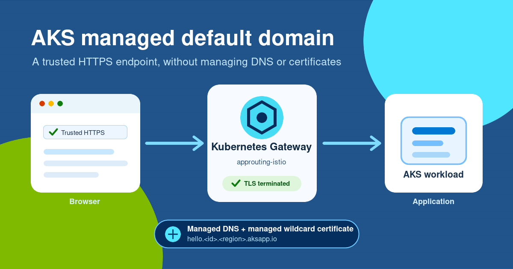

Getting an application online often takes more than deploying it. You need a domain, a DNS zone, a TLS certificate, and automation to keep the certificate and records current. That setup makes sense for a branded production endpoint, but it can slow down development, testing, demos, and proof-of-concept environments.

Today, we're introducing the **managed default domain for Azure Kubernetes Service (AKS)** in public preview. The feature gives an AKS cluster a domain under `aksapp.io`, a publicly trusted wildcard TLS certificate, and managed DNS records. You bring a workload and a Kubernetes `Gateway` and `HTTPRoute`; AKS manages the rest.

<!-- truncate -->



## One feature, three managed pieces

When you enable the default domain feature, AKS provides:

- **A stable cluster domain.** Each cluster receives a unique name in the form `<id>.<region>.aksapp.io`. The name remains assigned to the cluster if you disable and later reenable the feature.
- **A managed TLS certificate.** AKS issues and renews a publicly trusted wildcard certificate for `*.<id>.<region>.aksapp.io`. A `DefaultDomainCertificate` resource tells AKS which Kubernetes Secret should hold the certificate.
- **Managed DNS records.** A managed `external-dns` instance watches your Gateway API resources and publishes records for your route hostnames. The records point to the address reported by the `Gateway`.

The result is a trusted HTTPS endpoint such as `hello.<id>.<region>.aksapp.io`, without buying a domain, creating an Azure DNS zone, or operating certificate and DNS controllers yourself.

## How an endpoint comes together

The feature builds on the [AKS application routing add-on](https://learn.microsoft.com/azure/aks/app-routing) and the Kubernetes Gateway API:

1. AKS assigns the cluster its `aksapp.io` domain.
2. You create a `DefaultDomainCertificate` resource. AKS places the wildcard certificate in the Secret you name.
3. A `Gateway` listener references that Secret through `certificateRefs` and terminates TLS.
4. An `HTTPRoute` declares a hostname under the cluster domain and attaches to the `Gateway`.
5. Managed `external-dns` reads the route hostname and the address in `Gateway.status.addresses`, then publishes the DNS record.

This design keeps the Kubernetes resources portable and familiar. `certificateRefs`, `Gateway.status.addresses`, and route `status.parents` are all part of the standard [Kubernetes Gateway API specification](https://gateway-api.sigs.k8s.io/reference/api-spec/).

## Try it

The preview requires Azure CLI 2.86.0 or later, version 19.0.0b26 or later of the `aks-preview` extension, and a subscription registered for the feature. Install or update the extension first:

```bash
az extension add --name aks-preview
az extension update --name aks-preview
```

Register the preview:

```bash
az feature register \
  --namespace Microsoft.ContainerService \
  --name DefaultDomainPreview

az feature show \
  --namespace Microsoft.ContainerService \
  --name DefaultDomainPreview \
  --query properties.state \
  --output tsv
```

Wait for the feature state to become `Registered`, then refresh the AKS resource provider:

```bash
az provider register --namespace Microsoft.ContainerService
```

Create a cluster with application routing, its Gateway API implementation, the [Managed Gateway API installation](https://learn.microsoft.com/azure/aks/managed-gateway-api), and the default domain enabled:

```bash
export RESOURCE_GROUP=<resource-group-name>
export CLUSTER_NAME=<cluster-name>
export LOCATION=<supported-azure-region>

az aks create \
  --resource-group ${RESOURCE_GROUP} \
  --name ${CLUSTER_NAME} \
  --location ${LOCATION} \
  --enable-managed-identity \
  --enable-app-routing \
  --app-routing-default-nginx-controller None \
  --enable-app-routing-istio \
  --enable-gateway-api \
  --enable-default-domain \
  --generate-ssh-keys
```

Get cluster credentials and read the assigned domain:

```bash
az aks get-credentials \
  --resource-group ${RESOURCE_GROUP} \
  --name ${CLUSTER_NAME}

export DOMAIN=$(az aks approuting defaultdomain show \
  --resource-group ${RESOURCE_GROUP} \
  --name ${CLUSTER_NAME} \
  --query domainName \
  --output tsv)

export HOST="hello.${DOMAIN}"
```

Next, request the managed certificate. AKS writes it to a Secret named `cert` in the same namespace:

```bash
kubectl create namespace hello-world

kubectl apply -f - <<EOF
apiVersion: approuting.kubernetes.azure.com/v1alpha1
kind: DefaultDomainCertificate
metadata:
  name: cert
  namespace: hello-world
spec:
  target:
    secret: cert
EOF

kubectl wait \
  --for=condition=Available \
  defaultdomaincertificate/cert \
  --namespace hello-world \
  --timeout=5m
```

Deploy a sample application and Service:

```bash
kubectl create deployment hello-world \
  --namespace hello-world \
  --image mcr.microsoft.com/azuredocs/aks-helloworld:v1

kubectl expose deployment hello-world \
  --namespace hello-world \
  --port 80 \
  --target-port 80
```

Create an HTTPS `Gateway` that uses the managed certificate:

```bash
kubectl apply -f - <<EOF
apiVersion: gateway.networking.k8s.io/v1
kind: Gateway
metadata:
  name: hello-world
  namespace: hello-world
spec:
  gatewayClassName: approuting-istio
  listeners:
  - name: https
    hostname: "${HOST}"
    port: 443
    protocol: HTTPS
    tls:
      mode: Terminate
      certificateRefs:
      - name: cert
    allowedRoutes:
      namespaces:
        from: Same
EOF
```

Attach an `HTTPRoute` with the hostname that managed DNS should publish:

```bash
kubectl apply -f - <<EOF
apiVersion: gateway.networking.k8s.io/v1
kind: HTTPRoute
metadata:
  name: hello-world
  namespace: hello-world
spec:
  parentRefs:
  - name: hello-world
  hostnames:
  - "${HOST}"
  rules:
  - backendRefs:
    - name: hello-world
      port: 80
EOF
```

Wait for the `Gateway` to become ready:

```bash
kubectl wait \
  --for=condition=programmed \
  gateways.gateway.networking.k8s.io/hello-world \
  --namespace hello-world \
  --timeout=5m

echo "https://${HOST}"
```

Allow a short time for the managed DNS record to propagate, then copy the URL printed by the command and open it in a browser. The application appears over HTTPS. Notice the lock or site information icon next to the URL in the browser: it shows that the connection is secured by a publicly trusted, signed TLS certificate. You didn't need to configure a certificate issuer or create a DNS record manually.

## Availability and support

The managed default domain is available in selected Azure public regions during preview. See the [default domain documentation](https://learn.microsoft.com/azure/aks/app-routing-default-domain#supported-regions) for the current region list, complete prerequisites, and steps for enabling the feature on an existing cluster.

## Start with HTTPS, not certificate setup

The managed default domain removes the setup work between deploying a service and reaching it at a trusted HTTPS endpoint. It also lets you keep the Gateway API resources you'll use as an application grows. When you need a branded hostname, move to a [custom domain and certificate](https://learn.microsoft.com/azure/aks/app-routing-dns-ssl) while keeping the same routing model.

For the complete walkthrough, limitations, and supported regions, read [Use the managed default domain with the application routing add-on](https://learn.microsoft.com/azure/aks/app-routing-default-domain). If a certificate or DNS record doesn't become ready, follow [Troubleshoot the application routing default domain feature in AKS](https://learn.microsoft.com/troubleshoot/azure/azure-kubernetes/extensions/application-routing-default-domain).
