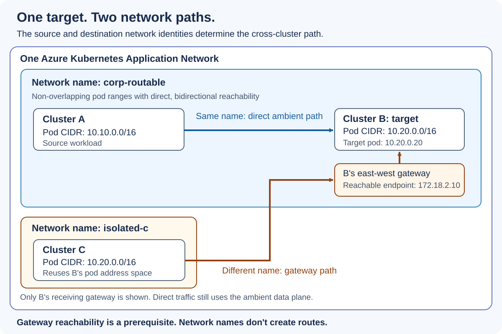

Azure Kubernetes Application Network (AppNet), currently in preview, aims to simplify network connectivity between clusters. In this post, we explore how to connect clusters with overlapping pod address spaces.

You have two Azure Kubernetes Service (AKS) clusters with unique pod ranges and working routes between them. Now, a third team wants to join with a cluster that uses a pod range you've already allocated elsewhere, and renumbering it could mean changing an existing cluster before you can connect the application.

You set `--network-name` on each AppNet member to describe which clusters share pod reachability and which need an east-west gateway between them.

<!-- truncate -->



## Flat and overlapping pod networks

With a **flat or contiguous pod network**, each cluster has a non-overlapping pod range and can reach the other clusters' pod IPs in both directions. The ranges can be far apart. `10.10.0.0/16` and `10.20.0.0/16` work just as well as neighboring blocks when the routes and security rules allow that traffic.

Keeping those ranges unique takes IP address management (IPAM). You need space for new clusters, plus room for existing clusters to grow and add temporary nodes during an upgrade. A deployment template that uses `10.20.0.0/16` can end up in several teams' clusters, even if each cluster's local address plan makes sense. [AKS address planning](https://learn.microsoft.com/azure/aks/concepts-network-ip-address-planning) covers the sizing requirements.

With **overlapping pod networks**, two isolated clusters use some or all of the same address range. Reusing `10.20.0.0/16` in B and C makes an address such as `10.20.0.20` ambiguous outside its own network. Keep those pod spaces separate. To send a request across that boundary, the source needs a reachable gateway address for the destination network.

Unique ranges don't guarantee a direct path. [Azure CNI Overlay](https://learn.microsoft.com/azure/aks/concepts-network-azure-cni-overlay) keeps pod addresses inside each cluster. Even with distinct pod ranges and peered VNets, those pods need a gateway-based path for the cross-cluster traffic described here.

## Give each member a network name

`--network-name` sets the optional member field `properties.connectivityProfile.network`. Use it when you join a cluster or update an existing member. The value identifies a mesh network and is separate from the Azure VNet resource name.

Use 2-63 characters for an explicit name. Start and end with a lowercase letter or digit. Between them, use lowercase letters, digits, dots (`.`), underscores (`_`), or hyphens (`-`). These rules are stricter than [Kubernetes label value syntax](https://kubernetes.io/docs/concepts/overview/working-with-objects/labels/#syntax-and-character-set): AppNet requires lowercase letters and at least two characters.

Assign the same name only after you confirm that the members' pod ranges don't overlap and that pods can reach each other in both directions. Different names make AppNet use east-west gateways between those networks.

Leaving the name out when you join gives that member its own default network identity. It uses the gateway path to other members. Check pod reachability before grouping members under a shared name, including when their address ranges are different.

## How the mixed setup works

The diagram puts A and B in `corp-routable`, while C uses `isolated-c`:

| Member | Pod address range | Network name |
| --- | --- | --- |
| A | `10.10.0.0/16` | `corp-routable` |
| B | `10.20.0.0/16` | `corp-routable` |
| C | `10.20.0.0/16` | `isolated-c` |

A and B use `corp-routable`, and their pod ranges are reachable, so a request from A goes directly through the ambient data plane to the target in B.

C takes a different path. Its `isolated-c` network reuses B's `10.20.0.0/16` range, so C sends traffic to the same target through B's east-west gateway at a separately reachable address.

Keeping A and B on their existing flat network lets them use the direct path, while C can join the same AppNet without changing its isolated pod range. Teams can add clusters as they're ready. IPAM still covers the addresses that need to be reachable between networks, including gateway endpoints.

AppNet keeps the east-west gateways and load balancers provisioned even when members share a network name. B still needs its gateway for requests from C. The diagram shows that receiving gateway and leaves out most proxy hops.

## Set the network names

Use Azure CLI **2.84.0 or later** with the `appnet-preview` extension **1.0.0b4 or later** for network-name commands. The extension uses API version `2026-08-01-preview`.

Before updating the three members in this example, confirm that they've joined AppNet and check [supported Application Network versions](https://learn.microsoft.com/azure/application-network/supported-versions) and the [multi-cluster prerequisites](https://learn.microsoft.com/azure/application-network/multi-cluster-connectivity#prerequisites). Replace the resource names and confirm that the network paths work before applying the commands.

```bash
export APPNET_RG="<appnet-resource-group>"
export APPNET_NAME="<appnet-name>"

az appnet member update \
    --resource-group "$APPNET_RG" \
    --appnet-name "$APPNET_NAME" \
    --member-name member-a \
    --network-name corp-routable

az appnet member update \
    --resource-group "$APPNET_RG" \
    --appnet-name "$APPNET_NAME" \
    --member-name member-b \
    --network-name corp-routable

az appnet member update \
    --resource-group "$APPNET_RG" \
    --appnet-name "$APPNET_NAME" \
    --member-name member-c \
    --network-name isolated-c
```

When you join a new cluster, pass `--network-name` to `az appnet member join` to choose its mesh network as part of onboarding. The JSON fragment shows where the network name goes in the member's connectivity profile:

```json
{
  "properties": {
    "connectivityProfile": {
      "network": "corp-routable"
    }
  }
}
```

## Establish network paths

Before A and B can use the direct path, you need routes and security rules that allow their pods to talk in both directions. C needs access to B's gateway.

Where the address spaces allow it, [VNet peering](https://learn.microsoft.com/azure/virtual-network/virtual-network-peering-overview) or a VPN can provide that path, but you still need to configure routing and the security rules that permit the traffic. AppNet doesn't create those connections when you set a network name.

Reusing pod ranges doesn't make overlapping VNets peerable. Keep gateway addresses reachable from the source network and follow the address-planning rules for your network plugin. The diagram uses example IPs, so work out the VNet and subnet layout for your own clusters.

Gateway visibility has its own setting. With `--east-west-gateway Internal`, the default, members in other networks need private connectivity to the gateway. Choose `External` for a public address when your security policy allows it. Kubernetes API-server access stays the same.

## Check a real request

Check the name stored on B, which should be `corp-routable` for this example:

```bash
az appnet member show \
    --resource-group "$APPNET_RG" \
    --appnet-name "$APPNET_NAME" \
    --member-name member-b \
    --query properties.connectivityProfile.network \
    -o tsv
```

Now test an application request.

Use pod reachability tests in both directions for A and B, and check that C's data plane can reach B's gateway on the required ports. On the application side, enroll the intended namespaces in ambient mode and mark the participating services as global, then make sure your authorization policies allow the caller's workload identity.

Network names leave those controls in place. Send requests from A and C and confirm that the backend in B handles them, checking logs or backend-specific responses so a successful call to a local backend doesn't hide a broken cross-cluster path.

The [multi-cluster guide](https://learn.microsoft.com/azure/application-network/multi-cluster-connectivity#verify-configuration-and-traffic) has the commands for checking member configuration and gateway endpoints, along with steps for testing application traffic between clusters.

### Try the mixed-network scenario

For a hands-on starting point, follow the [AppNet multi-cluster Bookinfo walkthrough](https://learn.microsoft.com/azure/application-network/traffic-management-use-cases#create-sample-application). It includes sample manifests, ambient enrollment, global-service configuration, and application requests. The [Bookinfo sample manifests](https://github.com/istio/istio/tree/release-1.29/samples/bookinfo) are also available in the Istio repository.

The walkthrough uses two clusters; it doesn't provision the three-cluster network layout in this post. To exercise both paths, keep B as the destination and use the walkthrough's source-cluster setup first in A, then in C:

| Test | Source and destination | Connectivity to establish first | What to verify |
| --- | --- | --- | --- |
| Direct path | A to B, both in `corp-routable` | Bidirectional pod-IP routes and security rules between A and B | A's request reaches a backend in B |
| Gateway path | C in `isolated-c` to B in `corp-routable` | Reachability from C's data plane to B's east-west gateway address and exposed ports, including response traffic | C's request reaches a backend in B despite the overlapping pod ranges |

Use the [connectivity guide's data-path checks](https://learn.microsoft.com/azure/application-network/multi-cluster-connectivity#validate-the-data-path) before each application test. For the gateway case, set `CONTEXT_B` to B's kubeconfig context, then inspect its gateway services with `kubectl --context "$CONTEXT_B" -n applink-system get services -o wide`. Check the addresses and ports against your routes and security rules; listing the services alone doesn't prove reachability.

Follow the walkthrough's application deployment and request steps for each source/destination pair, using matching service names and namespaces. Use B-specific backend responses or B's application logs to confirm the destination. A response from a local backend is not evidence that either cross-cluster path works.

## Next steps and resources

- [Configure multi-cluster connectivity](https://learn.microsoft.com/azure/application-network/multi-cluster-connectivity) for network prerequisites, member onboarding, and data-path checks.
- [Try the Bookinfo walkthrough](https://learn.microsoft.com/azure/application-network/traffic-management-use-cases) for application deployment, global services, traffic management, and authorization.
- [Watch the AppNet demo](https://aka.ms/aks/appnetdemo) for a guided demonstration of the application workflow.
- [Check supported AppNet versions](https://learn.microsoft.com/azure/application-network/supported-versions) before choosing your cluster and tooling versions.

Stay tuned for more updates to AppNet.
