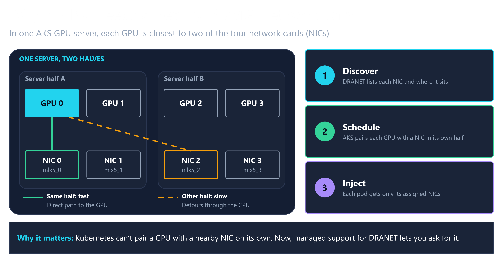
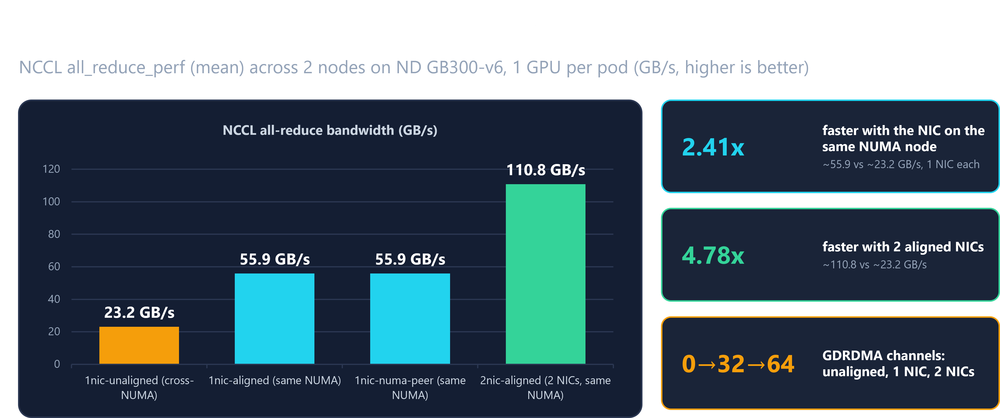

Training and serving large AI models can keep many GPUs exchanging data across servers. That data travels through network interface cards (NICs), and a faster GPU-to-network path means less time waiting for communication. Earlier this year, we published [Optimizing RDMA performance for AI workloads on AKS with DRANET](https://blog.aks.azure.com/2026/04/01/dranet-rdma-optimization-for-ai-on-aks), which covered the self-managed approach to using DRANET and Kubernetes Dynamic Resource Allocation (DRA) for topology-aware scheduling and GPU/NIC alignment in AI training and inferencing. That approach required customers to install and operate the networking components themselves.

This blog post builds on that work with managed support for DRANET, now generally available on Azure Kubernetes Service (AKS). Rather than introducing GPU–NIC alignment as a new capability, the managed integration brings DRANET deployment and lifecycle management into the AKS platform for supported RDMA-capable node pools. Workloads continue to request devices through Kubernetes DRA, including topology-aware requests that help pair GPUs with nearby NICs. Customers retain the Kubernetes-native allocation model while moving DRANET operations from a self-managed deployment to AKS.

<!-- truncate -->

## RDMA as a Kubernetes resource

DRA lets workloads describe specialized resource requirements through Kubernetes APIs. DRANET discovers eligible network devices on each node and publishes them through Kubernetes `ResourceSlices`. A workload requests devices using a DRA resource claim; Kubernetes uses the available resources during allocation, and DRANET prepares the selected devices for the workload.



Making devices available is only part of the story: which NIC a GPU receives also matters. In the example above, a GPU server is represented as two halves, A and B, each with two GPUs and two NICs. A GPU has a fast, direct path to the NICs in its own half. A NIC in the other half forces data to detour through the CPU, adding traffic across the server’s NUMA (Non-Uniform Memory Access) boundary. By default, Kubernetes does not automatically pair a GPU with a nearby NIC, so a workload can receive a less efficient pairing without an obvious warning.

Managed support for DRANET brings this physical layout into the allocation workflow on AKS:

1. **Discover**: DRANET finds each NIC and records where it sits in the server.
2. **Match**: With topology-aware resource requests, AKS can pair each GPU with a NIC in the same half of the server.
3. **Provide access**: Each pod sees only the NICs assigned to it.

This turns GPU–NIC proximity from a detail customers must account for manually into a resource requirement the platform can act on. The benchmark later in this blog measures the difference between a nearby NIC and one across the NUMA boundary.

### GPU and non-GPU workloads

RDMA is often associated with distributed GPU training, where communication can affect end-to-end performance. It is also useful for CPU-based distributed and HPC workloads (Managed support for DRANET is based on supported RDMA-capable VM configurations, not on whether a node has a GPU.)

## A shared foundation, distinct capabilities

DRANET and DRA also underpin [Multi-NIC support (preview) on AKS](https://learn.microsoft.com/azure/aks/configure-multiple-network-interfaces-for-pods), which lets pods request additional standard network interfaces. Multi-NIC is a separate capability and remains in public preview.

### Enable managed support for DRANET and request devices

You can enable the feature on new or existing node pools with an RDMA-capable VM size:

```bash
az aks nodepool update \
  --resource-group $RESOURCE_GROUP \
  --cluster-name $CLUSTER_NAME \
  --name $RDMA_POOL \
  --enable-managed-dranet=true
```

After enablement, AKS manages DRANET and networking drivers for that node pool to discover eligible RDMA devices and makes them available through DRA.

A workload references a `ResourceClaimTemplate` from its pod and declares the claim in the container that needs the NIC:

```bash
spec:
  resourceClaims:
    - name: rdma-nic
      resourceClaimTemplateName: rdma-dra-template
  containers:
    - name: workload
      resources:
        claims:
          - name: rdma-nic
```

For detailed deployment examples, steps to migrate from a self-managed Network Operator, and troubleshooting steps, check out the [AKS feature documentation](https://www.aka.ms/aks/managed-support-for-dranet).

## Performance depends on placement

We used NCCL `all_reduce_perf` to measure how GPU–NIC pairing affects communication throughput. NCCL is NVIDIA’s library for communication between GPUs. All-reduce combines results from participating GPUs and makes the combined result available to each one, which is a synchronization step that training must wait for before continuing. Faster all-reduce communication means less time spent waiting at that step to complete.

The test used two NVIDIA GB300 servers, with one worker pod and one GPU on each, so communication crossed the network. RDMA NICs were allocated through DRA, collective traffic was forced over InfiniBand, and message sizes ranged from 512 MiB to 8 GiB. The comparison changed NIC placement and count on the same hardware:



*NUMA describes a server architecture in which access paths differ depending on where processors, memory, and devices sit. Here, “same half” means the GPU and NIC are on the same NUMA node. Results describe this benchmark setup, not a guaranteed application-level speedup.*

Either nearby NIC delivered about 2.4 times the bandwidth of the cross-NUMA pairing. Giving the GPU two nearby NICs delivered about 4.8 times the cross-NUMA bandwidth. The NICs themselves were equally fast, at about 458 gigabits per second each; the difference was the path between the GPU and the NIC, plus the additional network capacity available when using two NICs.

In the cross-NUMA case, the CPU detour caused NCCL to disable direct GPU-to-network transfers, leaving 0 direct-transfer channels, compared with 32 for one aligned NIC and 64 for two. These results demonstrate why exposing a fast NIC is not enough: a workload also needs the right GPU–NIC pairing. Managed support for DRANET enables topology-aware allocation through Kubernetes resource requests, helping automate that pairing rather than leaving it to chance.

## Get started today

Managed support for DRANET brings simpler operations and topology-aware networking together: AKS automates DRANET’s deployment and lifecycle, and workloads express their device requirements through Kubernetes DRA. GPU workloads can request nearby NICs to avoid unnecessary communication detours, while non-GPU RDMA workloads use the same Kubernetes-native resource model. Get started with this feature today and [share your feedback](https://github.com/Azure/AKS) with the AKS product team! To learn more, visit:

* [Enable managed support for DRANET and deploy an RDMA workload](https://www.aka.ms/aks/managed-support-for-dranet)
* [Explore Multi-NIC support on AKS (preview)](https://learn.microsoft.com/azure/aks/configure-multiple-network-interfaces-for-pods)
* Learn about [Kubernetes Dynamic Resource Allocation](https://kubernetes.io/docs/concepts/resource-management/dynamic-resource-allocation/how-dra-works/)
