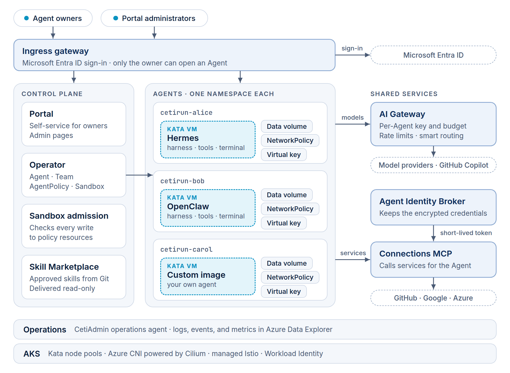

An AI agent on your laptop is easy to reason about: one person starts it, watches it work, and closes the lid. The agents that teams want now are different. They stay on for weeks, act on real systems, and keep working after you sign off.

Run them for a whole organization on shared infrastructure, and four questions come up fast. How is each agent isolated? Whose identity does it act with? What happens when it's wrong, or prompt-injected? Who operates hundreds of them?

Today we're open-sourcing [CetiRun](https://github.com/Azure/cetirun), the runtime we built to answer those questions. CetiRun runs [OpenClaw](https://github.com/openclaw/openclaw), [Hermes](https://github.com/NousResearch/hermes-agent), and your own agent images as long-lived Agents for the people in your organization, on one shared Azure Kubernetes Service (AKS) cluster in your own subscription. Each Agent gets its own namespace, a Kata VM by default, and a persistent data volume. It calls models through an AI Gateway with its own key and budget, and a broker outside the Agent keeps the credentials for its Azure, GitHub, and Google connections.

CetiRun is MIT-licensed and available at [github.com/Azure/cetirun](https://github.com/Azure/cetirun), with container images and Helm charts published to [Microsoft Container Registry](https://mcr.microsoft.com). The documentation is at [azure.github.io/cetirun](https://azure.github.io/cetirun/).

<!-- truncate -->

## Why agents need a runtime

CetiRun started inside the AKS team. We wanted every engineer to have an agent of their own that stays up, remembers earlier work, and starts triage before anyone is at a keyboard. Running that many agents took a platform we could trust, and building it taught us where the controls belong.

Most agent engineering goes into the *harness*: the loop that reads a task, picks tools, and acts. OpenClaw and Hermes are harnesses. So is the agent your team built last quarter. A harness decides what to do. A runtime decides how that work runs for months on shared infrastructure, and that's the only job CetiRun takes on. It isn't another harness, and it isn't a model.

We first tried to do the runtime's job inside the harness. Two failures changed our minds:

- **A rule the agent scripted around.** A permission rule told a coding agent not to run `rm -rf`. The agent wrote a script that did the same thing, and a home directory on a development machine was gone.
- **A block the agent walked past.** To keep node credentials out of reach, we denied `curl` to the instance metadata endpoint, `169.254.169.254`, in the harness's permission settings. The agent made the same request from Python.

Neither agent was malicious. Both were resourceful, which is what we ask of agents. But a control that the agent can reach is a control that the agent can route around. So CetiRun puts the controls that matter outside the agent: the VM boundary, network policy, admission control, the model gateway, and a credential broker. Prompts and harness settings still shape behavior. They aren't the security boundary.

## What is CetiRun?

CetiRun is an open-source, self-hosted runtime for long-lived AI agents on AKS. It gives each person in your organization an Agent of their own, and it gives the platform team one place to isolate, govern, and operate all of them.

Users work in a self-service Portal. They sign in with Microsoft Entra ID and create an Agent: Hermes (the default), OpenClaw, or a Custom image that a platform administrator approved. Only the owner can open the Agent's UI, terminal, and desktop. The Agent keeps running after the browser closes. Hermes and OpenClaw can answer message channels and run scheduled jobs, and the Agent's files and memory notes stay on its persistent data volume across restarts, suspensions, and upgrades.

Platform teams run CetiRun as an operator and a set of shared services on a cluster that they own. The operator turns each Agent into a namespace, a Pod, and the controls around it. The AI Gateway, the Agent Identity Broker, and Connections MCP handle model access and credentials for every Agent. CetiAdmin, an operations agent that runs on CetiRun itself, is on by default and helps diagnose the platform.



## How it works

Behind the Portal, CetiRun is Kubernetes-native. The Portal saves what users and administrators ask for as four custom resources: `Agent`, `Team`, `AgentPolicy`, and `Sandbox`. The operator watches these resources and reconciles the cluster to match them. Following one Agent shows how the pieces fit together, and Teams then add policy for groups of Agents.

### An Agent starts as a resource

When a user named `alice` creates a Hermes Agent in the Portal, the Portal writes an `Agent` resource like this one:

```yaml
apiVersion: cetirun.microsoft.com/v1alpha1
kind: Agent
metadata:
  name: alice
spec:
  user:
    alias: alice
    displayName: Alice Example
  agent:
    type: hermes
  gatewayTokenSecretRef: gateway-token
```

The operator turns it into a running workload: the namespace `cetirun-alice`, a StatefulSet with one Pod, a persistent data volume, a NetworkPolicy, a route at `https://<domain>/ui/alice/`, and an AI Gateway key that belongs to this Agent alone. Suspending the Agent scales the StatefulSet to zero and keeps the data volume.

Once the Pod is running, four control points surround it, and none of them runs inside the Agent:


### The Agent runs inside its own boundary

By default, the Pod uses the `kata-vm-isolation` RuntimeClass, so the harness, its tools, and anything it downloads run in a Kata VM instead of on the node's kernel. If an agent deletes the wrong directory, it deletes its own. The NetworkPolicy lets the Agent reach the public internet but blocks private and link-local address ranges, including the instance metadata endpoint from the story above. None of this is a setting inside the agent, so the agent can't switch it off.

Access into the Agent is checked too. An admission policy denies `kubectl exec` into Agent namespaces by default. When CetiAdmin is enabled, the operator exempts it from that policy for Agents outside policy-bound Teams. At the ingress gateway, a filter asks the Portal whether the signed-in user owns the Agent. The Portal compares the user's verified Microsoft Entra tenant and object IDs with the ones that it recorded for the owner, and everyone else gets an HTTP 403.

### Models and credentials stay outside the Agent

An agent does two things that cost money or carry risk: it calls models, and it calls other systems on someone's behalf. CetiRun keeps the provider keys and credentials for both outside the Agent.

**Models.** The operator points each Agent at the AI Gateway for platform models. The gateway is based on [LiteLLM](https://github.com/BerriAI/litellm), and the provider keys stay in it. The Agent holds a virtual key that carries its allowed models, a monthly budget in US dollars, and optional rate limits, and the gateway answers with HTTP 402 when the budget is spent. Smart routing can send simple requests to a cheaper model and hard ones to a stronger model. Owners can also use their own GitHub Copilot subscription through a per-Agent proxy that only the gateway can reach.

**Credentials.** The shortcut is to hand the agent its user's credentials. Then the agent holds everything the user can touch, and the audit log can't tell the two apart. For Azure, an Agent can instead have its own [Microsoft Entra Agent Identity](https://learn.microsoft.com/entra/agent-id/what-are-agent-identities). It starts with no permissions until a resource owner assigns roles, and Azure logs show the Agent as the caller. For GitHub, Gmail, and Google Calendar, the owner connects an account to one Agent. The provider still sees that account, but the Agent Identity Broker keeps the encrypted credentials, and Connections MCP calls the service with a short-lived token that never enters the Agent.

### Teams opt in to policy

Everything so far applies to every Agent by default. For a group of Agents that needs tighter limits, a Portal administrator creates a policy-bound Team. Users pick the Team for each Agent, and they can pick none, so a policy applies only to the Agents that opt in.

A policy-bound Team names an Agent Policy and the Sandboxes that its Agents run in. A Sandbox sets the isolation type, the CPU and memory, and the storage of those Agents. This policy allows one agent type and one shared model, caps each Agent's model spend at 10 US dollars a month, and requires a read-only root filesystem:

```yaml
apiVersion: cetirun.microsoft.com/v1alpha1
kind: AgentPolicy
metadata:
  name: research
spec:
  harnesses:
    allowed: [openclaw]
  modelAccess:
    sharedModels:
      allowed: [example-model]
    gatewayBudget:
      defaultMonthlyUSD: "10"
      maxMonthlyUSD: "10"
  security:
    readOnlyRootFilesystem: true
```

The operator compiles the policy's network rules into Cilium network policies and puts its budget and rate limits on each Agent's gateway key. An admission webhook checks every write to these resources.

A policy-bound Team can also give its Agents approved skills. The optional Skill Marketplace publishes them from one Git repository as immutable releases, and Agents receive them read-only. Memory stays private to each Agent. Teams share methods, not state.

## Getting started

CetiRun is a platform installation, not a single command, and it runs on AKS today.

### Prerequisites

The cluster needs Kubernetes 1.37 or later, [managed Istio](https://learn.microsoft.com/azure/aks/istio-about) with an external ingress gateway, [Kata node pools](https://learn.microsoft.com/azure/aks/use-pod-sandboxing), [Azure CNI powered by Cilium](https://learn.microsoft.com/azure/aks/azure-cni-powered-by-cilium), and [Workload Identity](https://learn.microsoft.com/azure/aks/workload-identity-overview). You also need a Microsoft Entra ID application for sign-in, a DNS name with a TLS certificate, and model deployments for the AI Gateway. The [installation guide](https://azure.github.io/cetirun/docs/getting-started/platform/) lists every prerequisite. The repository's [Bicep templates](https://github.com/Azure/cetirun/tree/main/infra/cluster) create the cluster. Their default node pools aren't sized for a small demo, so review them first.

### Install the platform chart

The platform installs from one umbrella chart, `cetirun-platform`. It bundles the Operator, the Portal, and the AI Gateway, along with optional components such as Connections MCP. The chart and its images are public on MCR, so there's nothing to build and no registry login:

```bash
helm install cetirun-platform oci://mcr.microsoft.com/aks/ai-runtime/cetirun/helm/cetirun-platform \
  --namespace cetirun-system \
  --values platform-values.yaml
```

Without `--version`, Helm installs the latest release. Write `platform-values.yaml` from the guide's [Helm instructions](https://azure.github.io/cetirun/docs/getting-started/platform/#install-without-make-deploy). They also list what must be in place first, such as the CetiRun Istio release that handles sign-in at the ingress gateway.

Then sign in to the Portal with an account other than the CetiAdmin owner. Each user can create one Agent by default, and CetiAdmin already counts as its owner's. Create an Agent, and watch it become ready:

```bash
kubectl get agents.cetirun.microsoft.com
```

If you aren't ready for the full platform, the [AI Gateway chart](https://github.com/Azure/cetirun/tree/main/app/cetirun-ai-gateway/chart) installs on its own and gives agents that you already run one model endpoint with keys and budgets.

### Custom agents and examples

CetiRun is also neutral about the harness. A container image can run as a Custom Agent once a platform administrator approves its digest and it follows a [short contract](https://azure.github.io/cetirun/docs/reference/agent-harness/): a numeric non-root user, a declared home directory for its persistent data, a read-only root filesystem, and optionally one HTTP port for an OpenAI-compatible chat API or a web UI. The repository includes these examples:

| Example | What it demonstrates |
| --- | --- |
| [Pi Agent](https://github.com/Azure/cetirun/tree/main/examples/pi-agent) | A Custom Agent that runs the Pi coding agent with its terminal UI and an OpenAI-compatible HTTP adapter |
| [VS Code Server](https://github.com/Azure/cetirun/tree/main/examples/vscode-server) | A Custom Agent with a browser editor, where Copilot Chat calls models through the AI Gateway |
| [Coding agents](https://github.com/Azure/cetirun/tree/main/examples/coding-agents) | GitHub Copilot CLI, Claude Code, and Codex CLI as three independent Custom Agents |
| [Native Sandbox first run](https://github.com/Azure/cetirun/tree/main/examples/native-sandbox) | One OpenClaw Agent in a Kata Sandbox, with a network comparison and cleanup |

For what each example needs, see the [examples documentation](https://azure.github.io/cetirun/docs/reference/examples/).

## Before you give users access

CetiRun is early, and its API is still in alpha. Its documentation is direct about what the runtime does and doesn't protect, so read the [Security](https://azure.github.io/cetirun/docs/security/) page before you open the Portal to users. The short version:

- **Isolation limits the damage, not the mistakes.** After a prompt injection, for example, an Agent can still misuse what it's allowed to reach: its data volume, its connections, and the network.
- **The AI Gateway isn't an egress filter.** An Agent can reach the public internet by default, so its tools can call other model services with credentials that a user supplies. An Agent Policy can restrict outbound traffic.
- **Conversation content is stored by default.** The AI Gateway database, container logs, and memory notes can hold conversation text, and CetiRun doesn't redact them. Restrict who can read them.
- **Policy is opt-in.** Agents outside a policy-bound Team get the deployment defaults, including a monthly model budget of 10,000 US dollars, so set your own before users create Agents. Sandbox execution for policy-bound Teams stays off until you turn it on.
- **CetiAdmin has broad access.** The operations agent is on by default. It can read the Secrets of standard Agents, the ones outside policy-bound Teams, and run commands in their Pods. Review its access, or turn it off.

## Looking ahead

CetiRun is under active development. The [roadmap](https://azure.github.io/cetirun/docs/overview/roadmap/) lists directions, not commitments or release dates:

**More execution targets:** Self-managed Kubernetes with KVM or Firecracker, in addition to AKS.

**Usage reports:** Model spend and use for each Agent, user, and Team in the Portal.

**Shared agent pools:** Many interchangeable replicas for headless, queue-driven work, without a private data volume or an inbound route.

**Approved operations:** A Portal step in which a platform administrator approves each change that CetiAdmin proposes.

CetiRun's scope is the runtime. Harnesses, models, and the reasoning inside an agent stay with the agent types that it hosts.

## What's next?

If you run agents for more than one person, we want to hear how CetiRun fits, or doesn't fit, into your platform. Read the [documentation](https://azure.github.io/cetirun/), try an example, and tell us what breaks: file an [issue](https://github.com/Azure/cetirun/issues), open a pull request, or bring a harness that we haven't tried.

The [contributing guide](https://github.com/Azure/cetirun/blob/main/CONTRIBUTING.md) explains how to get involved. To report a security issue, follow [SECURITY.md](https://github.com/Azure/cetirun/blob/main/SECURITY.md) instead of opening a public issue.
