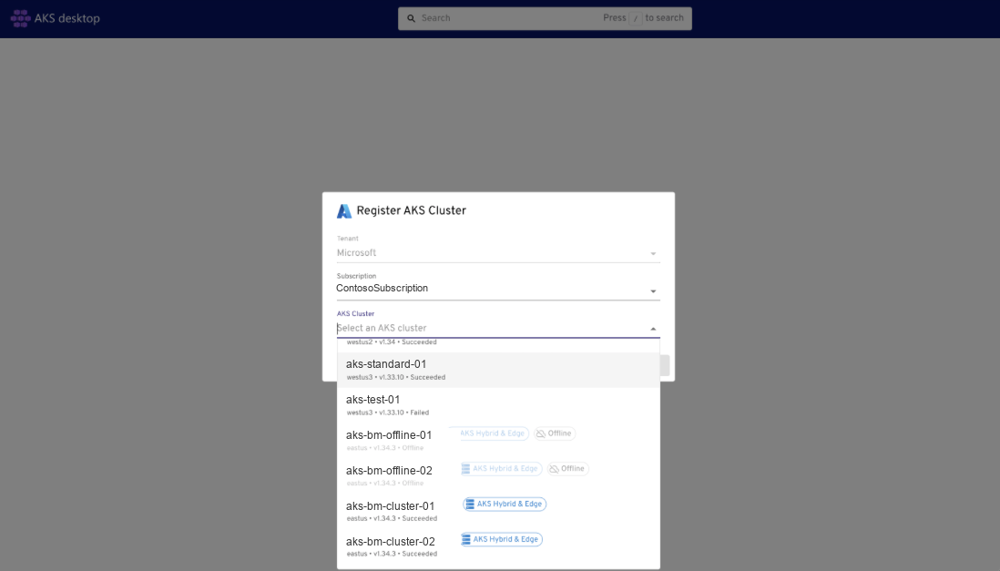
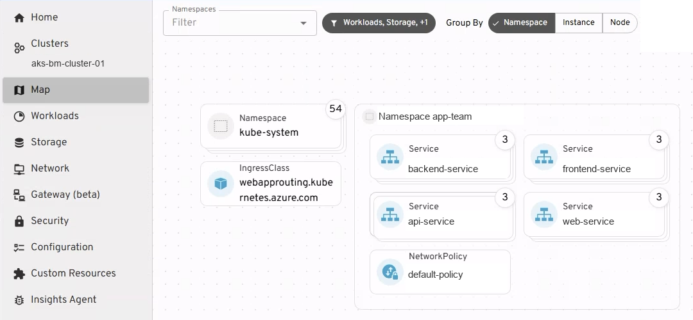

Running Kubernetes on your own hardware changes where the cluster lives. It shouldn't mean starting over with how you connect to it and understand what's running.

In our [previous AKS desktop post](https://blog.aks.azure.com/2026/09/24/aks-desktop-ai-troubleshooting), we talked about shortening the path from seeing a problem to understanding what to do next. There is another part of that experience that comes first: getting connected to the cluster.

Starting with AKS desktop v0.11.0, support for connecting to AKS on bare metal clusters is available in preview. You can add an existing cluster from Azure and explore its Kubernetes resources in AKS desktop, without opening an inbound firewall port to its Kubernetes API server.

<!-- truncate -->

The goal is straightforward: spend less time setting up the connection and more time working with the cluster.

> **Preview:** AKS on bare metal support requires AKS desktop v0.11.0 or later. Preview features are provided without a service-level agreement and aren't recommended for production workloads. Some capabilities might be limited or unsupported.

## Start with the cluster, not the connection setup

Before you can investigate a workload, you need a way to reach the Kubernetes API server. For clusters running on your own hardware, that connection deserves just as much attention as the interface you use after signing in.

AKS desktop connects to supported AKS on bare metal clusters without requiring an inbound firewall rule for the Kubernetes API server.

Outbound connectivity is still required. Review the [network requirements](https://learn.microsoft.com/azure/azure-arc/kubernetes/network-requirements), including the endpoints required for cluster connect.

AKS desktop handles the local cluster connect proxy as part of opening the cluster. Rather than starting a proxy manually each time, you select your saved cluster, and AKS desktop starts and verifies the proxy before loading its resources.

## Add your bare-metal cluster alongside your other clusters

Start with an existing online AKS on bare metal cluster. AKS desktop isn't provisioning the hardware or creating the cluster. It provides the desktop experience for connecting to and working with that cluster.

Sign in to AKS desktop with the Microsoft Entra account that has access to your cluster, then choose **Add Cluster from Azure**. Select the subscription and cluster, review the displayed cluster and access information, and choose **Register Cluster**.

In the registration experience, AKS desktop identifies these clusters as **AKS Hybrid & Edge**. Saved clusters use the **AKS Hybrid & Edge** label.

*Select an existing AKS on bare metal cluster from Azure and register it in AKS desktop.*

Once registered, the cluster appears in **All Clusters** alongside your other clusters. Select it, and AKS desktop establishes the proxy connection before opening the cluster view.

That is the connection workflow we want to simplify: choose the cluster you need to work with, then get to its resources.

## Move from connecting to understanding what's running

Once connected, you can use the standard AKS desktop cluster resource experience to explore the cluster.

The Map view is one example. It brings Kubernetes resources together visually, grouped by namespace, so you can orient yourself before drilling into individual resources.

*Use the familiar cluster resource experience after AKS desktop establishes the connection.*

Connecting is only the beginning. With AKS desktop, you can explore workloads on your AKS on bare metal cluster, deploy an application into a [Project](https://learn.microsoft.com/azure/aks/aks-desktop-projects), and use the [AI Assistant](https://learn.microsoft.com/azure/aks/aks-desktop-deploy-ai-assistant) to begin troubleshooting.

<iframe
  width="100%"
  height="400"
  src="https://www.youtube.com/embed/2zKa0Ec4CXo"
  title="Connect, deploy, and explore AKS on bare metal with AKS desktop"
  loading="lazy"
  referrerPolicy="strict-origin-when-cross-origin"
  allow="accelerometer; autoplay; clipboard-write; encrypted-media; gyroscope; picture-in-picture; web-share"
  allowFullScreen
></iframe>

[Watch the companion walkthrough on YouTube](https://youtu.be/2zKa0Ec4CXo).

Available resources and actions still depend on the cluster's capabilities and your permissions. Connecting a bare-metal cluster doesn't mean every managed cloud AKS feature is available, and this preview shouldn't be read as feature parity across deployment options.

## Keep access boundaries intact

An easier connection shouldn't mean broader access.

AKS desktop uses your current Azure sign-in and the authorization model configured for the cluster. It doesn't bypass Azure RBAC or Kubernetes RBAC, and it doesn't automatically request broader permissions if an operation is denied.

There are two parts to that access: permission to connect to the cluster, and permission to perform the Kubernetes operations you need. See the [authentication and access configuration guidance](https://learn.microsoft.com/azure/azure-arc/kubernetes/cluster-connect#set-up-authentication) for the required role assignments and Kubernetes permissions.

That distinction matters. Being able to connect to a cluster doesn't automatically make you its administrator.

For initial use, start with a nonproduction cluster, follow the [connection prerequisites](https://learn.microsoft.com/azure/azure-arc/kubernetes/cluster-connect#prerequisites), and grant only the access required for the task.

If the automatic connection fails, AKS desktop also provides a **Start AKS Hybrid & Edge proxy** action in the cluster's menu. This is a troubleshooting option, not an extra step in the normal workflow.

## Why this matters to me

What I like about this preview is that it makes where a cluster runs less of a dividing line in the day-to-day experience.

The infrastructure still matters. A cluster on your own hardware has its own capabilities, network requirements, and operational responsibilities. A desktop application doesn't remove those differences.

But getting connected and understanding what's running shouldn't require a completely separate experience. Bringing AKS on bare metal into AKS desktop is a step toward making that work more consistent: select the cluster, connect to it, and explore the resources your identity is allowed to access.

Download [AKS desktop v0.11.0 or later](https://github.com/Azure/aks-desktop/releases), try the preview with an existing nonproduction AKS on bare metal cluster, and [tell us what works and where we should improve](https://github.com/Azure/aks-desktop/issues/new/choose).

**For the step-by-step walkthrough, see [Connect to and manage AKS on bare metal clusters with AKS desktop](https://aka.ms/aks/desktop/baremetal).**
