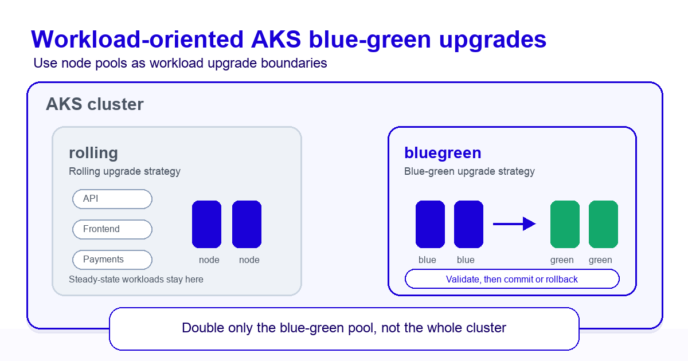

Blue-green upgrades are usually described as a safer way to update infrastructure: bring up the new environment, move traffic or workloads over, validate, and keep a rollback path open. In Azure Kubernetes Service (AKS), [blue-green node pool upgrades](https://learn.microsoft.com/azure/aks/blue-green-node-pool-upgrade) apply that model to node pools.

That raises an important design question: if the feature operates at the node-pool level, how do you make it workload-focused? Treat node pools as workload upgrade boundaries. Segment workloads across node pools, choose the right upgrade strategy for each pool, and use blue-green only where the validation and rollback benefits justify the temporary capacity, quota, and cost requirements.

The [blue-green node pool upgrade documentation](https://learn.microsoft.com/azure/aks/blue-green-node-pool-upgrade) covers feature configuration, supported scenarios, and limitations. This post focuses on workload placement: isolating the subset of workloads that needs hosting-environment validation and rapid fallback, applying blue-green to that pool, and limiting the temporary capacity increase.

<!-- truncate -->



## Two blue-green upgrade boundaries

[Cluster-level blue-green deployments](https://learn.microsoft.com/azure/architecture/guide/aks/blue-green-deployment-for-aks) use two separate AKS clusters and switch application traffic between them after validation. This provides a cluster-level replacement boundary.

[Blue-green node pool upgrades](https://learn.microsoft.com/azure/aks/blue-green-node-pool-upgrade) retain the existing cluster and add upgraded green nodes alongside the original blue nodes within a node pool. Workloads move between those nodes, with a rollback option during the final soak period.

This post focuses on the second approach: choosing which workloads share a node-pool upgrade boundary and where the validation and fallback benefits justify the temporary capacity.

Node pool blue-green upgrades still require extra capacity during the upgrade window. AKS drains workloads from blue to green in batches, while both sets of nodes temporarily exist:

- You need quota and regional capacity for the temporary nodes.
- You pay for both blue and green nodes during the upgrade.
- You extend the upgrade timeline to include batch and final soak periods.

Those tradeoffs are pool-scoped. The design question is "Which workloads benefit from a blue-green node-pool upgrade boundary?"

## A workload-aware node pool strategy

Most production AKS clusters already use more than one node pool. Platform teams separate workloads by VM SKU, GPU needs, Spot usage, compliance boundary, operating system, or validation and rollback requirements. Upgrade strategy can become another dimension of that design.

Blue-green isn't limited to a particular workload type. It's useful when a workload is sensitive to changes in its hosting environment, such as the kernel, container runtime, or node image, and needs a rapid fallback if problems emerge after moving to upgraded nodes. The deciding questions are: what could change the workload's behavior, what signals would reveal a regression, and how quickly do you need to return to the previous environment? Keeping the original nodes available during the final soak period provides that fallback, within the supported rollback window.

For example, imagine a cluster with two user node pools:

| Node pool | Workloads | Upgrade strategy | Why |
| --- | --- | --- | --- |
| `rolling` | Workloads whose tested disruption handling and recovery approach meet their upgrade requirements | Rolling | The workload can tolerate incremental node replacement without retaining the original nodes for rapid fallback. |
| `bluegreen` | Workloads needing hosting-environment validation and rapid fallback | BlueGreen | Retain the original nodes while validating behavior after migration, with rollback available during final soak. |

The pool names reflect the upgrade strategy, not workload importance. `rolling` uses standard rolling upgrades. `bluegreen` uses blue-green upgrades for workloads that benefit from explicit validation before the old nodes are removed.

Customer-facing and business-critical workloads can belong in either pool. Choose based on sensitivity to hosting-environment changes, validation needs, and recovery requirements, not whether the workload serves external users. Neither strategy removes the need for application availability design.

You don't need enough spare capacity to duplicate the entire cluster. By placing the subset of workloads that needs hosting-environment validation and rapid fallback on a dedicated node pool, you limit the temporary capacity increase to that pool. For example, with eight nodes in a rolling pool and two in a blue-green pool, upgrading only the blue-green pool adds two temporary nodes, not ten. The selected pool still needs capacity to double, but the rest of the cluster doesn't.

## Tailor the upgrade boundary

Start with the workloads that need hosting-environment validation and rapid fallback, then group them on a dedicated user node pool. The pool must be large enough for those workloads' resource requests, availability requirements, and placement constraints; the goal is a useful recovery boundary, not simply the smallest possible pool.

Use node labels with a `nodeSelector` or required node affinity to place those workloads on the selected pool. A matching taint and toleration can keep unrelated workloads without that toleration off the pool. A toleration alone doesn't direct a workload there. Confirm actual placement before upgrading so the workloads you intend to validate are inside the boundary.

Choose drain batches based on how much disruption the applications can handle, and honor their PodDisruptionBudgets. Smaller batches change the pace of migration, not the requirement for enough capacity to temporarily double the selected pool.

:::tip

Choose batch and final soak durations based on how long your monitoring and application checks need to detect meaningful regressions. A short soak may finish before a periodic job runs or a slow-developing issue becomes visible.

:::

Use the [configuration documentation](https://learn.microsoft.com/azure/aks/blue-green-node-pool-upgrade#customize-blue-green-upgrade-properties) for supported settings and the [AKS scheduling guidance](https://learn.microsoft.com/azure/aks/operator-best-practices-advanced-scheduler) for workload-placement options.

## Upgrade only the blue-green pool

:::info

Blue-green node pool upgrades are currently in preview and aren't meant for production use. Try this pattern in a non-production cluster. Review the [AKS preview feature support policy](https://learn.microsoft.com/azure/aks/support-policies) for support terms and limitations.

:::

With the workload boundary in place, explicitly target the blue-green pool first. This lets you validate workload behavior on the upgraded nodes before choosing to upgrade other pools. The rolling pool isn't targeted by this command and stays unchanged during this operation.

The following example assumes an existing user pool named `bluegreen`, the current [preview prerequisites](https://learn.microsoft.com/azure/aks/blue-green-node-pool-upgrade#prerequisites), and sufficient quota and capacity for its green nodes. Set `RESOURCE_GROUP` and `CLUSTER_NAME` to your existing resources, and `TARGET_K8S_VERSION` to a supported upgrade version no newer than the control plane. Configure soak durations before starting so you have time to validate and, if necessary, roll back.

```bash
az aks nodepool upgrade \
  --resource-group "$RESOURCE_GROUP" \
  --cluster-name "$CLUSTER_NAME" \
  --name bluegreen \
  --kubernetes-version "$TARGET_K8S_VERSION" \
  --upgrade-strategy bluegreen \
  --no-wait
```

AKS cordons the blue nodes, adds green nodes with the updated configuration, and drains pods from blue to green in batches. The command returns without waiting for completion; monitor the upgrade and the workloads rather than treating command submission as success. AKS doesn't infer application intent; you express it through node pool design and scheduling.

:::info

Don't assume the same pool ordering for cluster-wide or automatic upgrades. Users don't control the order in which AKS upgrades node pools, so configuring one pool for blue-green doesn't make it a validation gate for the others. If validation on that pool must happen first, explicitly orchestrate separate node-pool upgrades.

:::

Disabling automatic node OS upgrades isn't a prerequisite for blue-green. Blue-green also supports the automatic security patch channel when the node pool is configured for the blue-green strategy. See the [security patch guidance](https://learn.microsoft.com/azure/aks/blue-green-node-pool-upgrade#can-i-use-the-automatic-security-patch-channel-with-blue-green-upgrades) for details.

## Validate before the final commit

Blue-green upgrades are most useful when you do something with the soak window. Confirm that the intended workloads have moved to upgraded green nodes and that the expected replicas are ready. Readiness alone isn't proof of application health; compare behavior against the baseline from before the upgrade.

:::tip

For meaningful validation, add checks that match your application:

- Synthetic requests through the service or ingress path.
- SLO and error-budget checks in Azure Monitor or your observability stack.
- Application logs filtered to the workloads on the blue-green pool.
- Business-specific smoke tests.

:::

If validation passes, let the final soak complete and AKS removes the old blue nodes. If validation fails during the final soak period, follow the documented [abort and rollback procedure](https://learn.microsoft.com/azure/aks/blue-green-node-pool-upgrade#roll-back-a-blue-green-upgrade) before the old nodes are removed. This fallback is time-bound; once the final soak expires and the blue nodes are deleted, that rollback path is no longer available.

## When this pattern works well

This is a good fit when:

- You already segment workloads by ownership, runtime requirements, or validation needs.
- A smaller set of workloads needs compatibility validation on new node images or Kubernetes versions.
- You have the quota, regional capacity, and cost tolerance to temporarily double the blue-green pool, but not the whole cluster.
- Your platform team can enforce placement with affinity, taints, tolerations, and admission policy.

It is less of a fit when capacity is not available for the temporary green nodes, or when the application has no meaningful validation signal before users notice a problem.

## Conclusion

Blue-green node pool upgrades give AKS users a safer option for Kubernetes and node image upgrades, with validation time and rollback optionality before old nodes are removed. That safety usually comes with capacity, quota, and cost tradeoffs because green nodes run alongside blue nodes during the upgrade window.

You can mitigate those tradeoffs by thinking about where blue-green applies at the workload level. Kubernetes scheduling and placement let you map specific workloads to a blue-green node pool, while other workloads continue using rolling upgrades on separate pools. The result is not blue-green for every node in the cluster, but a targeted blue-green upgrade boundary for the workloads that benefit most from validation before commit.

Try this pattern in a non-production cluster with a workload that benefits from node-level compatibility testing. Follow the [blue-green node pool upgrade documentation](https://learn.microsoft.com/azure/aks/blue-green-node-pool-upgrade) for setup, supported configurations, and current limitations. Share your scenarios and feedback through [Azure/AKS GitHub issues](https://github.com/Azure/AKS/issues).
